# Korre knowledge base

**Local update, 10 October 2026:** the game is now **Counterball**. Seven caps per player, a plastic button with visible holes, and placed foul/throw-in/penalty restarts supersede the earlier rules. Read [the revised rules](COUNTERBALL_RULES.md) and [current context](CONTEXT.md) before using the historical transcript below.

Imported from [Branch · Plan Counters Game UX](https://chatgpt.com/share/6ac982b4-b490-83e9-a223-d8aa0bf771af) on **10 October 2026**.

- [Current context and decisions](CONTEXT.md): confirmed choices, later corrections, open questions, and proposed defaults.
- [Asset inventory](assets/README.md): downloaded references and original attachment availability.
- [Original message archive](conversation.json): full visible text, interactive component source, and source metadata.
- [Asset manifest](assets/manifest.json): URLs, sizes, hashes, and download status.

## Coverage and reading notes

All **19 visible messages** appear below, in source order: **9 user messages and 10 assistant messages**. The assistant count includes the final progress note. Hidden draft duplicates, internal system records, reasoning records, and tool traffic are excluded.

The conversation evolves. Read the current context and final audit before using an earlier “final” specification. The latest audit corrects AI scope, pitch walls, identity, visuals, and the Cloudflare memory assumption. Three gameplay questions remain unanswered.

All 21 unique resolved reference images downloaded successfully. The user supplied the original **[image(2).png](assets/image%282%29.png)** locally on 10 October 2026. The initial download returned HTTP 401; the screenshot is now available.

Original interactive source remains in `conversation.json`. Below, references use local images and citations use source links. Other UI template markup appears as text; Markdown cannot execute the original controls. Message times use **Africa/Lagos (UTC+01:00)**. No new game decisions were made during import.

## Conversation index

- [Message 01 — User](#message-01)
- [Message 02 — Assistant](#message-02)
- [Message 03 — User](#message-03)
- [Message 04 — Assistant](#message-04)
- [Message 05 — User](#message-05)
- [Message 06 — Assistant](#message-06)
- [Message 07 — User](#message-07)
- [Message 08 — Assistant](#message-08)
- [Message 09 — User](#message-09)
- [Message 10 — Assistant](#message-10)
- [Message 11 — User](#message-11)
- [Message 12 — Assistant](#message-12)
- [Message 13 — User](#message-13)
- [Message 14 — Assistant](#message-14)
- [Message 15 — User](#message-15)
- [Message 16 — Assistant](#message-16)
- [Message 17 — User](#message-17)
- [Message 18 — Assistant](#message-18)
- [Message 19 — Assistant](#message-19)

# Complete visible conversation

<a id="message-01"></a>

## Message 01 — User

2026-10-09 18:21:19 UTC+01:00 · Message ID: `4ba212a7-6f20-4fc9-8f25-ac6af842dc6f`

> Original attachment: **image(2).png** (1869 × 1033, 594,249 bytes). Now supplied locally: [view screenshot](assets/image%282%29.png). See the [asset manifest](assets/manifest.json).

I want to build this game from the ground up...

I'm building a game ecosystem in named "Korre" the idea being a lot of games in there free to play by people...

but anyways I don't want to waste time on the technicalities, the first came I want to launch is counters...and I want to clone what's in [https://naijagames.app/](https://naijagames.app/) this current game is a very very great and unique one that's personal to me because I played it a lot physically ofc when I was a kid.

you flick a "counter" (we called it, it's just cover of a glass coke bottle) to hit a cloth button, the goal being to hit it into a post...search the web I'm sure someone has put out the details of the rules...

then what we just need to focus on is planning the game ux and figuring out the best platform to build it on...3js?

---

<a id="message-02"></a>

## Message 02 — Assistant

2026-10-09 18:21:23 UTC+01:00 · Message ID: `99d04cd5-220e-4137-ac8b-655042e8afbc`

# Korre: Counters

I think **Three.js is an excellent candidate**, but I'd actually recommend **React Three Fiber (R3F) + Rapier physics** for the first version.

The important distinction is that you're not just building a football game. You're recreating a physical childhood game whose appeal comes from the *feel* of flicking bottle caps, controlling their trajectory, and trying to score.

That changes how we should approach both the technology and UX.

## 1. What we're actually building

&lt;box gap={2}&gt;
  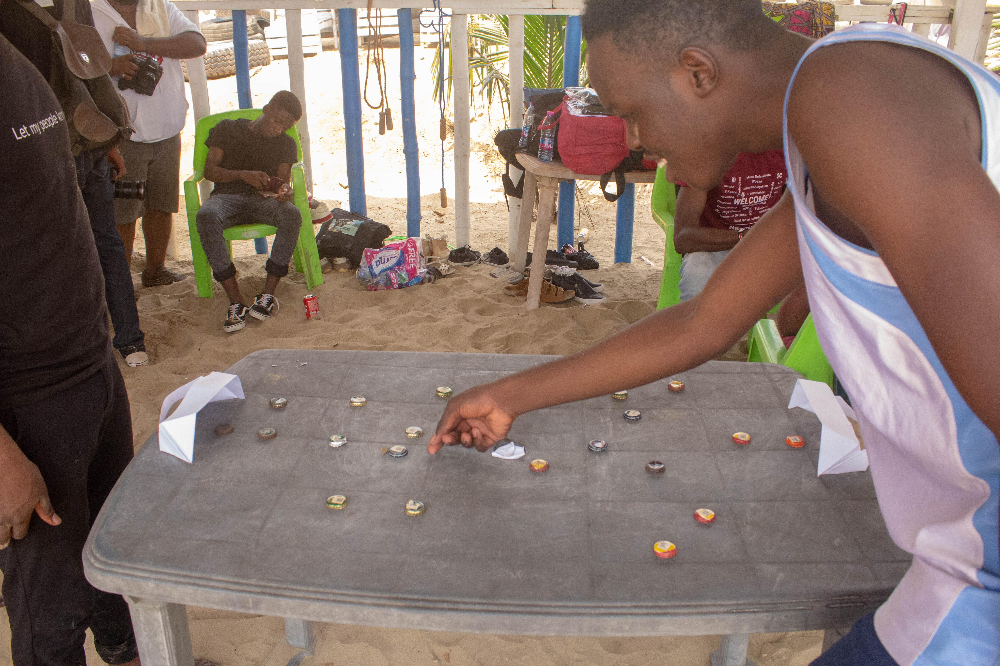
  &lt;caption&gt;The physical inspiration: bottle caps as players, a button as the ball, and goals at either end.&lt;/caption&gt;
&lt;/box&gt;

From your screenshot, the digital game already has a useful foundation:

- **3D tabletop environment:** A miniature football pitch on a wooden table.
- **Physics-based flicking:** Pull back on a counter to determine direction and force.
- **Two teams:** Bottle caps positioned like football players.
- **Button ball:** The object players must strike into the opponent's goal.
- **Camera controls:** Rotate and inspect the table from different angles.
- **Turn-based play:** Players take turns making shots.

I'd preserve the physical game's character rather than immediately introducing conventional football mechanics.

The key design principle: **make it feel like you're flicking a real bottle cap, not controlling a football player.**

## 2. Platform decision

I'd build Korre as a **web-first gaming ecosystem**, with games that run instantly through shared links, on both mobile and desktop.

| Option | Strength | Verdict |
|---|---|---|
| Three.js | Direct control over 3D rendering | Good |
| React Three Fiber | Three.js with declarative scene composition | **My pick** |
| Babylon.js | More integrated 3D game framework | Strong alternative |
| Godot | Dedicated game engine, mature tooling | Better for larger games |
| Unity | Comprehensive game development ecosystem | Unnecessary overhead here |

### Proposed stack

&lt;box border radius="lg" padding={3} gap={2}&gt;
  &lt;box align="center" gap={1}&gt;
    &lt;box background="surface-secondary" radius="md" padding={3} width="100%" align="center"&gt;
      **Korre Platform**

      &lt;text color="secondary" size="xs"&gt;Accounts · Game discovery · Friends · Leaderboards&lt;/text&gt;
    &lt;/box&gt;
    &lt;icon name="arrow-down" color="tertiary"/&gt;
    &lt;box background="rgba(35,131,226,0.08)" border={{size:1,color:"rgba(35,131,226,0.25)"}} radius="md" padding={3} width="100%" align="center"&gt;
      **Counters Game**

      &lt;text color="secondary" size="xs"&gt;React + React Three Fiber + Drei&lt;/text&gt;
    &lt;/box&gt;
    &lt;icon name="arrow-down" color="tertiary"/&gt;
    &lt;grid columns={2} gap={2}&gt;
      &lt;grid-item&gt;
        &lt;box background="surface-secondary" padding={3} radius="md" align="center" gap={1}&gt;
          **Rapier**

          &lt;text color="secondary" size="2xs"&gt;Physics simulation&lt;/text&gt;
        &lt;/box&gt;
      &lt;/grid-item&gt;
      &lt;grid-item&gt;
        &lt;box background="surface-secondary" padding={3} radius="md" align="center" gap={1}&gt;
          **Zustand**

          &lt;text color="secondary" size="2xs"&gt;Game state&lt;/text&gt;
        &lt;/box&gt;
      &lt;/grid-item&gt;
    &lt;/grid&gt;
    &lt;icon name="arrow-down" color="tertiary"/&gt;
    &lt;box background="surface-secondary" radius="md" padding={3} width="100%" align="center"&gt;
      **Multiplayer Server**

      &lt;text color="secondary" size="xs"&gt;Authoritative turns · Physics validation · Matchmaking&lt;/text&gt;
    &lt;/box&gt;
  &lt;/box&gt;
&lt;/box&gt;

Rapier supports rigid bodies, collisions, impulses, fixed timesteps and simulation snapshots, all useful for Counters.  [Source 1](https://github.com/pmndrs/react-three-rapier/blob/main/packages/react-three-rapier/readme.md), [Source 2](https://github.com/pmndrs/react-three-rapier).

One architectural decision matters: **keep the simulation independent of the rendering layer**. That makes it easier to support multiplayer, replays, bots, and potentially other game clients.

## 3. Counters UX

I'd organize the experience into three stages.

&lt;box gap={3}&gt;
  &lt;row align="start" gap={3}&gt;
    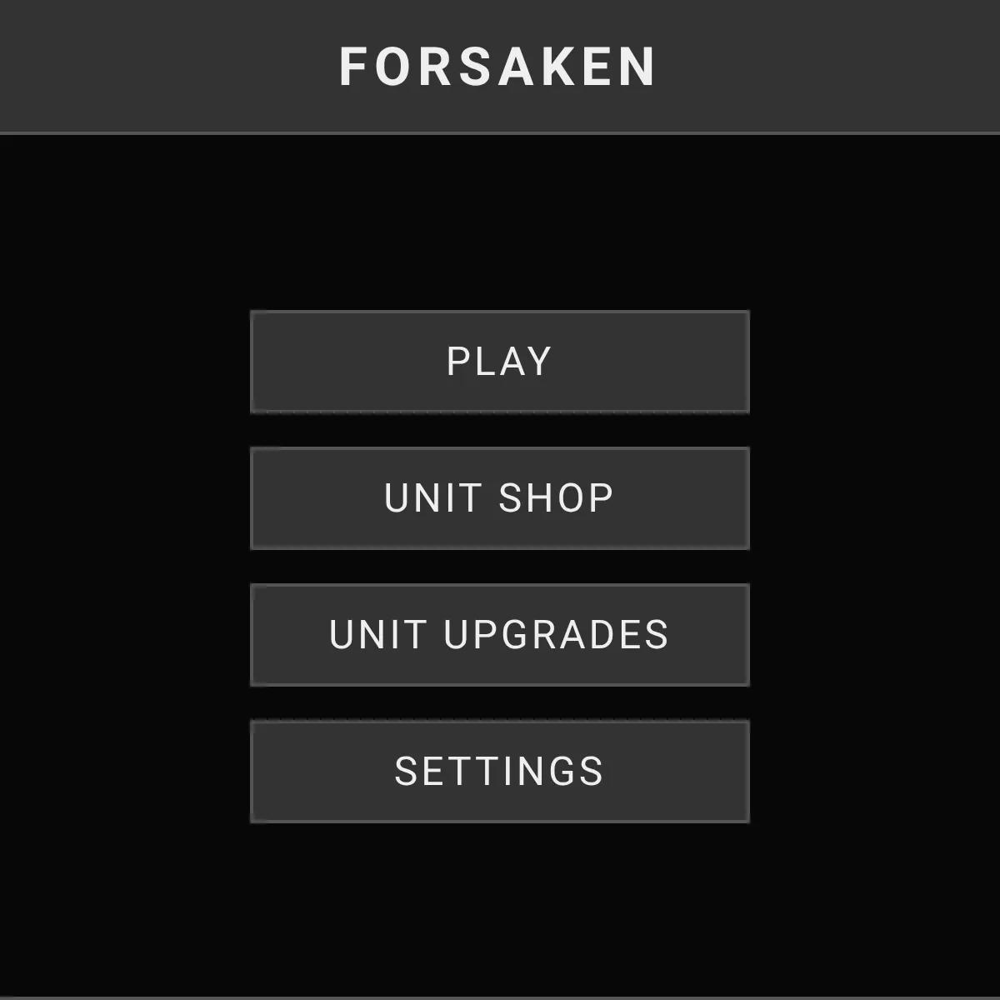
    &lt;box flex="1" gap={1}&gt;
      **Before the match**

      Quick Play, Play with Friend, Practice, and an extremely short interactive tutorial. No account requirement for a first game.
    &lt;/box&gt;
  &lt;/row&gt;
  &lt;divider color="subtle"/&gt;
  &lt;row align="start" gap={3}&gt;
    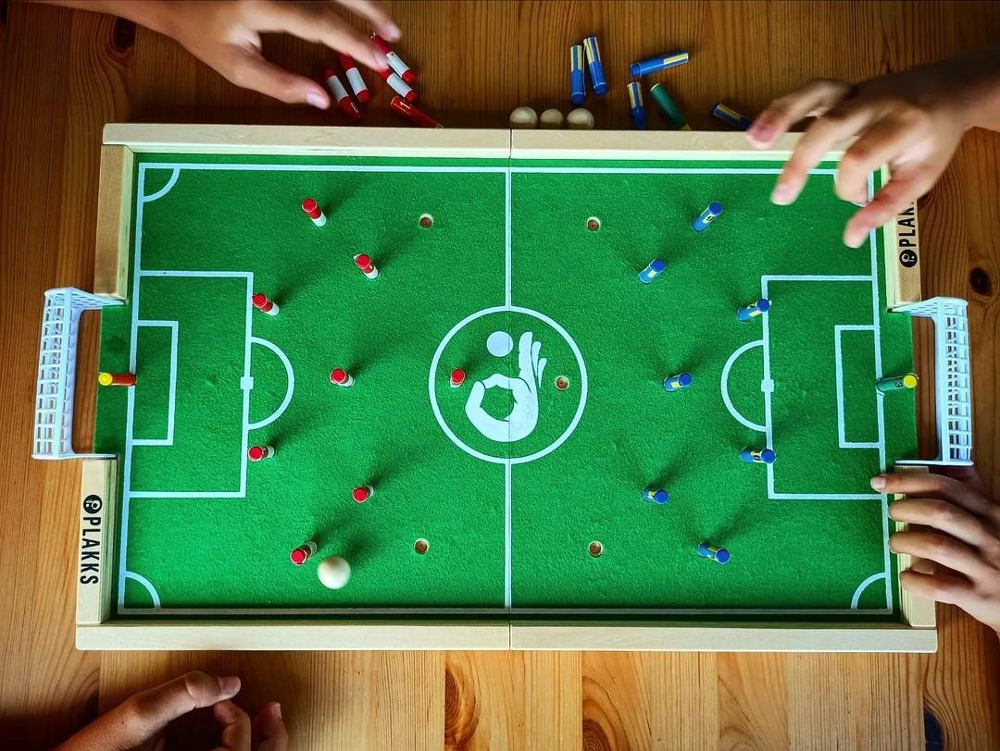
    &lt;box flex="1" gap={1}&gt;
      **During the match**

      Clean camera, obvious turn indicator, drag-to-flick controls, trajectory feedback, scoreboard and optional camera rotation.
    &lt;/box&gt;
  &lt;/row&gt;
  &lt;divider color="subtle"/&gt;
  &lt;row align="start" gap={3}&gt;
    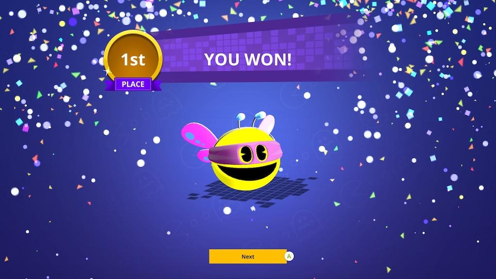
    &lt;box flex="1" gap={1}&gt;
      **After the match**

      Score, instant rematch, shareable result, invite link and optional account creation to save progress.
    &lt;/box&gt;
  &lt;/row&gt;
&lt;/box&gt;

For the actual flick interaction, I'd prototype two approaches: pulling backward directly from the counter, as in your screenshot, and a touch-friendly aiming control that doesn't require your finger to cover the counter.

## 4. MVP scope

I'd build in this order:

1. **Physics playground:** Pitch, caps, button, collisions, friction and flick controls.
2. **Playable match:** Turn system, scoring, goals, resets and rules.
3. **Game feel:** Sounds, camera transitions, animations, visual polish.
4. **Multiplayer:** Private rooms and invite links.
5. **Korre integration:** Game lobby, identity, match history and discovery.

I wouldn't begin with realistic human avatars or an elaborate environment. The table and pieces should look convincing, but the physics and controls deserve most of the attention.

## 5. The rules need verification

I searched for publicly documented Nigerian Counters rules, but couldn't find a sufficiently reliable source to establish the traditional rules. I also couldn't independently verify the exact rules implemented by NaijaGames.

So I'd rather reconstruct the rules with you than accidentally design a different game.

Three questions:

{@body const [rules,setRules] = DIL.useState("turns")}
{@body const [launch,setLaunch] = DIL.useState("web")}
{@body const [style,setStyle] = DIL.useState("physical")}
&lt;box gap={3}&gt;
  &lt;box gap={2}&gt;
    &lt;text weight="medium"&gt;1. How did turns work when you played?&lt;/text&gt;
    &lt;radio-group direction="col" value={rules} onChange={setRules}&gt;
      &lt;radio value="turns"&gt;Players alternate flicks&lt;/radio&gt;
      &lt;radio value="retain"&gt;You keep playing while you successfully hit the button&lt;/radio&gt;
      &lt;radio value="other"&gt;Different rules, I'll explain&lt;/radio&gt;
    &lt;/radio-group&gt;
  &lt;/box&gt;
  &lt;divider color="subtle"/&gt;
  &lt;box gap={2}&gt;
    &lt;text weight="medium"&gt;2. What's Korre's intended first platform?&lt;/text&gt;
    &lt;radio-group direction="col" value={launch} onChange={setLaunch}&gt;
      &lt;radio value="web"&gt;Web first, mobile browser included&lt;/radio&gt;
      &lt;radio value="mobile"&gt;Native mobile apps first&lt;/radio&gt;
      &lt;radio value="both"&gt;Web and native simultaneously&lt;/radio&gt;
    &lt;/radio-group&gt;
  &lt;/box&gt;
  &lt;divider color="subtle"/&gt;
  &lt;box gap={2}&gt;
    &lt;text weight="medium"&gt;3. How closely should we recreate the physical experience?&lt;/text&gt;
    &lt;radio-group direction="col" value={style} onChange={setStyle}&gt;
      &lt;radio value="physical"&gt;Very closely, including realistic physics&lt;/radio&gt;
      &lt;radio value="arcade"&gt;Same rules, but more arcade-like and playful&lt;/radio&gt;
      &lt;radio value="hybrid"&gt;Physical realism with some arcade enhancements&lt;/radio&gt;
    &lt;/radio-group&gt;
  &lt;/box&gt;
  &lt;button block onClick={()=&gt;GenUI.issueNewTurn("For Korre Counters: turn rules = "+({turns:"Players alternate flicks",retain:"Successful hits let you continue",other:"Different rules, need to explain"}[rules])+"; initial platform = "+({web:"Web first",mobile:"Native mobile first",both:"Web and native simultaneously"}[launch])+"; game feel = "+({physical:"Realistic physical simulation",arcade:"Arcade-style",hybrid:"Realism with arcade enhancements"}[style])+". Let's use these to refine the gameplay rules and UX.")}&gt;Continue planning &lt;icon name="arrow-right" inline/&gt;&lt;/button&gt;
&lt;/box&gt;

The most consequential question is actually the first. **The rules determine the game's state machine, multiplayer architecture and even how we design the flick controls.** I'd settle those before implementing the game.

---

<a id="message-03"></a>

## Message 03 — User

2026-10-09 18:23:55 UTC+01:00 · Message ID: `ff778960-82e2-46aa-b797-0550f37d12e0`

For Korre Counters: turn rules = Players alternate flicks; initial platform = Web first; game feel = Realistic physical simulation. Let's use these to refine the gameplay rules and UX.

---

<a id="message-04"></a>

## Message 04 — Assistant

2026-10-09 18:23:59 UTC+01:00 · Message ID: `09e59d40-b642-43c9-86e1-22bff65b77ef`

# Korre Counters: Gameplay & UX v0.1

We're optimizing for three things:

1. **Authenticity:** The physics should resemble flicking real bottle caps across a tabletop.
2. **Accessibility:** Anyone should understand how to play within 30 seconds.
3. **Competitive depth:** Simple controls, but enough precision and strategy for skilled players to consistently outperform beginners.

## 1. Core gameplay loop

&lt;box border radius="lg" padding={3} gap={2}&gt;
  &lt;box align="center" gap={1}&gt;
    &lt;box background="surface-secondary" padding={3} radius="md" width="100%" align="center"&gt;
      **Player A's turn**

      &lt;text color="secondary" size="xs"&gt;Select one of your counters&lt;/text&gt;
    &lt;/box&gt;
    &lt;icon name="arrow-down" color="tertiary"/&gt;
    &lt;box background="surface-secondary" padding={3} radius="md" width="100%" align="center"&gt;
      **Aim and flick**

      &lt;text color="secondary" size="xs"&gt;Pull back to set direction and power&lt;/text&gt;
    &lt;/box&gt;
    &lt;icon name="arrow-down" color="tertiary"/&gt;
    &lt;box background="surface-secondary" padding={3} radius="md" width="100%" align="center"&gt;
      **Physics simulation**

      &lt;text color="secondary" size="xs"&gt;Caps and button collide, slide and settle&lt;/text&gt;
    &lt;/box&gt;
    &lt;icon name="arrow-down" color="tertiary"/&gt;
    &lt;box background="surface-secondary" padding={3} radius="md" width="100%" align="center"&gt;
      **Resolve outcome**

      &lt;text color="secondary" size="xs"&gt;Check for goal, foul or out-of-bounds&lt;/text&gt;
    &lt;/box&gt;
    &lt;icon name="arrow-down" color="tertiary"/&gt;
    &lt;box background="rgba(35,131,226,0.08)" border={{size:1,color:"rgba(35,131,226,0.3)"}} padding={3} radius="md" width="100%" align="center"&gt;
      **Player B's turn**

      &lt;text color="secondary" size="xs"&gt;Repeat until the match ends&lt;/text&gt;
    &lt;/box&gt;
  &lt;/box&gt;
&lt;/box&gt;

The game should be **turn-based but physically continuous**. After a flick, every object retains its new position. The board becomes progressively more strategic.

## 2. Flicking interaction

&lt;box gap={2}&gt;
  &lt;svg viewBox="0 0 340 206" width="100%" xmlns="http://www.w3.org/2000/svg"&gt;
    &lt;rect x="8" y="8" width="324" height="190" rx="12" fill="#24683D"/&gt;
    {#each Array.from({length:10},(_,i)=&gt;i) as i}&lt;path d={`M ${22+i*32} 10 V 196`} stroke="#FFFFFF" strokeOpacity=".035" strokeWidth="15"/&gt;{/each}
    &lt;path d="M 170 9 V 197" stroke="white" strokeOpacity=".5" strokeWidth="1.4"/&gt;
    &lt;circle cx="170" cy="103" r="39" fill="none" stroke="white" strokeOpacity=".5" strokeWidth="1.4"/&gt;
    &lt;circle cx="225" cy="79" r="12" fill="#282C37" stroke="#8F96A5" strokeWidth="3"/&gt;
    &lt;circle cx="118" cy="129" r="13" fill="#BD2B40" stroke="#F8CE60" strokeWidth="4"/&gt;
    &lt;circle cx="118" cy="129" r="6" fill="#283D85"/&gt;
    &lt;circle cx="118" cy="129" r="19" fill="none" stroke="#F8CF73" strokeWidth="1.5" strokeDasharray="4 4"/&gt;
    &lt;path d="M118 129 L183 78" stroke="#FFF3BA" strokeWidth="3" strokeLinecap="round"/&gt;
    &lt;path d="M183 78 l-16 4 l8 10 z" fill="#FFF3BA"/&gt;
    &lt;path d="M118 129 L74 164" stroke="#FFD47D" strokeWidth="2" strokeDasharray="5 4"/&gt;
    &lt;circle cx="74" cy="164" r="8" fill="#FBD38B" fillOpacity=".85"/&gt;
    &lt;rect x="188" y="20" width="132" height="35" rx="7" fill="#102A20" fillOpacity=".9"/&gt;
    &lt;text x="254" y="34" fill="white" fontSize="10" textAnchor="middle"&gt;Shot direction&lt;/text&gt;
    &lt;text x="254" y="46" fill="#EFD28C" fontSize="9" textAnchor="middle"&gt;Power: 68%&lt;/text&gt;
    &lt;text x="22" y="184" fill="white" fontSize="10"&gt;Drag backward to aim&lt;/text&gt;
  &lt;/svg&gt;
  &lt;caption&gt;Conceptual top-down control diagram. Pulling backward determines the opposite launch direction and power.&lt;/caption&gt;
&lt;/box&gt;

For realism, I'd avoid exaggerated aiming assistance in competitive play. Instead:

- Highlight the selected cap.
- Show a short direction indicator and power feedback.
- Cancel the shot by dragging back onto the cap.
- Release to flick.
- Apply impulse at the cap's position, with the possibility of spin later.

An important detail: **realistic physics doesn't mean maximum friction accuracy at all costs**. We need to calibrate how far caps slide and how strongly they collide until the interaction feels familiar.

## 3. Camera and interface

I'd use two camera modes:

&lt;grid columns={2} gap={3}&gt;
  &lt;grid-item&gt;
    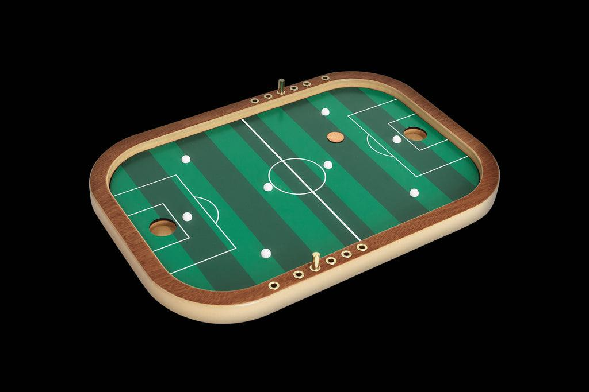
    **Perspective mode**

    &lt;text color="secondary" size="xs"&gt;Default immersive view. Shows the physical table and depth.&lt;/text&gt;
  &lt;/grid-item&gt;
  &lt;grid-item&gt;
    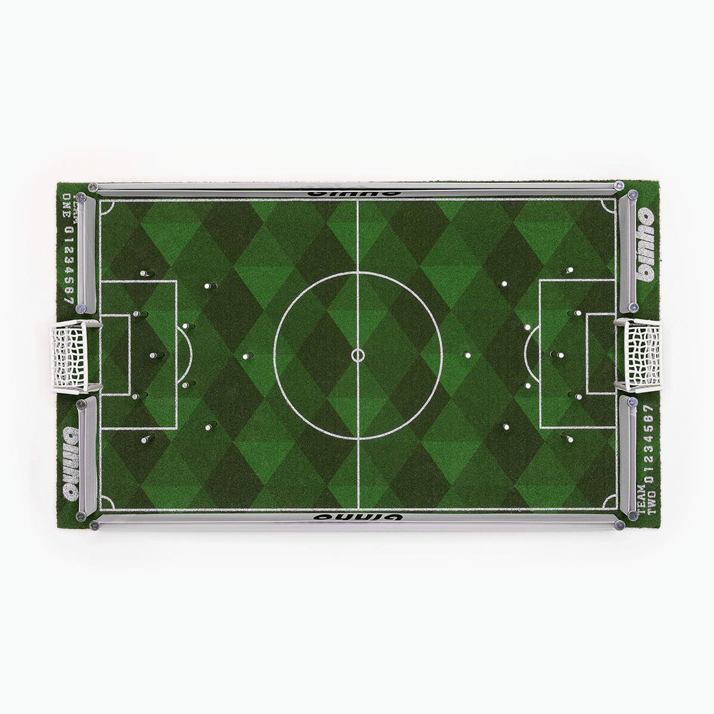
    **Tactical mode**

    &lt;text color="secondary" size="xs"&gt;Optional near-overhead view for precise shots and positioning.&lt;/text&gt;
  &lt;/grid-item&gt;
&lt;/grid&gt;

On mobile, the pitch should occupy most of the screen. The interface can be extremely minimal: score and turn indicator at the top, camera and settings buttons at the edges, and contextual flick feedback directly on the pitch.

## 4. Rules we still need to establish

Alternating turns is confirmed, but several rules will materially change the gameplay.

{@body const [hits,setHits] = DIL.useState("any")}
{@body const [miss,setMiss] = DIL.useState("switch")}
{@body const [out,setOut] = DIL.useState("reset")}
{@body const [match,setMatch] = DIL.useState("first3")}
&lt;box border radius="xl" padding={3} gap={3}&gt;
  &lt;box gap={2}&gt;
    &lt;text weight="medium"&gt;1. Which counters can a player flick?&lt;/text&gt;
    &lt;radio-group direction="col" value={hits} onChange={setHits}&gt;
      &lt;radio value="any"&gt;Any counter belonging to their team&lt;/radio&gt;
      &lt;radio value="nearest"&gt;Only the counter nearest the button&lt;/radio&gt;
      &lt;radio value="restricted"&gt;Other restrictions&lt;/radio&gt;
    &lt;/radio-group&gt;
  &lt;/box&gt;
  &lt;divider color="subtle"/&gt;
  &lt;box gap={2}&gt;
    &lt;text weight="medium"&gt;2. What happens when a player misses the button?&lt;/text&gt;
    &lt;radio-group direction="col" value={miss} onChange={setMiss}&gt;
      &lt;radio value="switch"&gt;Turn passes normally&lt;/radio&gt;
      &lt;radio value="foul"&gt;A foul or penalty is awarded&lt;/radio&gt;
      &lt;radio value="other"&gt;Another rule&lt;/radio&gt;
    &lt;/radio-group&gt;
  &lt;/box&gt;
  &lt;divider color="subtle"/&gt;
  &lt;box gap={2}&gt;
    &lt;text weight="medium"&gt;3. What happens when the button leaves the pitch?&lt;/text&gt;
    &lt;radio-group direction="col" value={out} onChange={setOut}&gt;
      &lt;radio value="reset"&gt;Return it to the field&lt;/radio&gt;
      &lt;radio value="throw"&gt;Opponent gets a restart&lt;/radio&gt;
      &lt;radio value="none"&gt;No out-of-bounds rule&lt;/radio&gt;
    &lt;/radio-group&gt;
  &lt;/box&gt;
  &lt;divider color="subtle"/&gt;
  &lt;box gap={2}&gt;
    &lt;text weight="medium"&gt;4. How should a match end?&lt;/text&gt;
    &lt;radio-group direction="col" value={match} onChange={setMatch}&gt;
      &lt;radio value="first3"&gt;First to 3 goals&lt;/radio&gt;
      &lt;radio value="timer"&gt;Timed match&lt;/radio&gt;
      &lt;radio value="turns"&gt;Fixed number of turns&lt;/radio&gt;
    &lt;/radio-group&gt;
  &lt;/box&gt;
  &lt;button block onClick={()=&gt;GenUI.issueNewTurn("For Counters: counter selection = "+hits+"; missed button = "+miss+"; out-of-bounds = "+out+"; match ending = "+match+". Refine the rules and game UX using these choices.")}&gt;Apply rules &lt;icon name="arrow-right" inline/&gt;&lt;/button&gt;
&lt;/box&gt;

One further question worth thinking about: **Do you want Counters to be a faithful digital preservation of the childhood game, or the definitive competitive version of it?**

Those goals can coexist, but I'd make the traditional rules the foundation and introduce competitive variants separately. That gives Korre a recognizable cultural identity without limiting how far the game can evolve.

---

<a id="message-05"></a>

## Message 05 — User

2026-10-09 18:54:12 UTC+01:00 · Message ID: `aa512e5d-7bd3-4dee-87ea-d829be70200e`

wait, why don't we use babylon js? pls


1. there are fouls, if you hit another player's counter without hitting the ball, it's a foul...the reward is that the offended player gets to play twice
2. yup...but in the reference game, there's a sort of "play" for the flick, once you release the gamera angle shoes the person's hand (a cut of it and weird, weird is fine) flicking it and camera following it to it's destination, we can play around with this "flick playback".
3. On the reference game, you can change the angle and camera...so I'll go with that...
4. &#x20;any counter, sometimes you just want to position your counter into defense mode
5. nothing
6. first to N goals, we can base it at 3


starting out, let's just replicate the game, I intend to add a leaderboard and make it competitive later, larger boards, custom counter sets/design (sometimes we add rubber weights under the counters to make them hit better)...but that's for later pls

---

<a id="message-06"></a>

## Message 06 — Assistant

2026-10-09 18:54:14 UTC+01:00 · Message ID: `af3a5133-1526-44c6-a604-4dc4b28548d5`

**Let's use Babylon.js.** There's no compelling reason to prefer Three.js for Counters, especially since you want a proper 3D game rather than a 3D experience embedded in a React application.

Babylon.js gives us a more integrated game-development environment.

| Capability | Babylon.js | Three.js |
|---|---|---|
| 3D rendering | Built-in | Built-in |
| Physics | Havok integration | External library |
| Camera systems | Built-in camera types | Cameras + custom controllers |
| Animations | Built-in animation system | Built-in, often supplemented |
| Asset loading | Built-in loaders | Built-in loaders |
| GUI | Babylon GUI | HTML or external UI |
| Development approach | Game-engine oriented | Rendering-library oriented |

Both are capable. **Babylon.js is my preference for this particular game**, primarily because of its integrated systems and camera tooling.

# Counters: Revised MVP specification

## 1. Gameplay rules

| Mechanic | Rule |
|---|---|
| Players | 2 |
| Teams | Each player controls their own counters |
| Turns | Players alternate flicks |
| Selection | Any counter belonging to the current player |
| Movement | Flick any counter, including for repositioning |
| Scoring | Flick the button into the opponent's goal |
| Fouls | Hitting an opponent's counter without hitting the button |
| Foul reward | Offended player gets two consecutive flicks |
| Missed button | No penalty unless a foul occurs |
| Out-of-bounds | No special penalty |
| Victory | First to 3 goals |
| Physics | Realistic collisions, momentum and friction |

For the foul rule, we'll need to track the order of collisions during each shot, not simply whether two counters touched.

One edge case: if a flick hits the opponent's counter first and then the button, does that still count as a foul? We can settle that when implementing the referee logic.

## 2. Flick playback

This is one of the most interesting parts of the reference game.

I'd separate **the actual physics simulation** from **the cinematic presentation**.

&lt;box gap={2}&gt;
  &lt;box border radius="lg" padding={3} gap={2}&gt;
    &lt;row align="center" justify="between"&gt;
      **Shot sequence**
      &lt;badge color="secondary"&gt;Concept&lt;/badge&gt;
    &lt;/row&gt;
    &lt;grid columns={3} gap={2}&gt;
      &lt;grid-item&gt;
        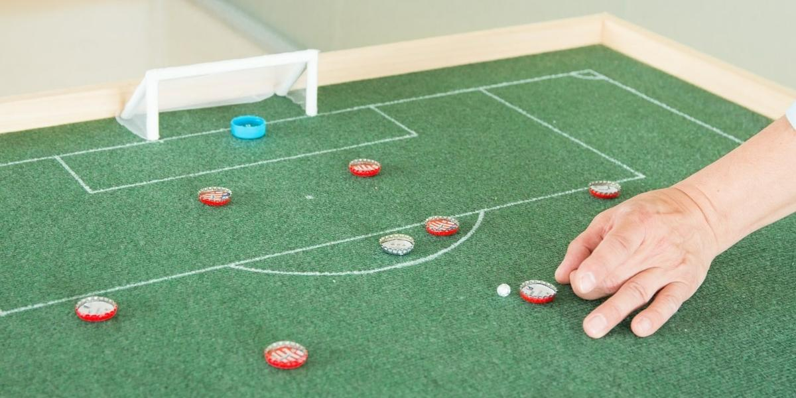
        &lt;text weight="medium" size="xs"&gt;1. Aim&lt;/text&gt;
        &lt;text color="secondary" size="2xs"&gt;Player pulls backward&lt;/text&gt;
      &lt;/grid-item&gt;
      &lt;grid-item&gt;
        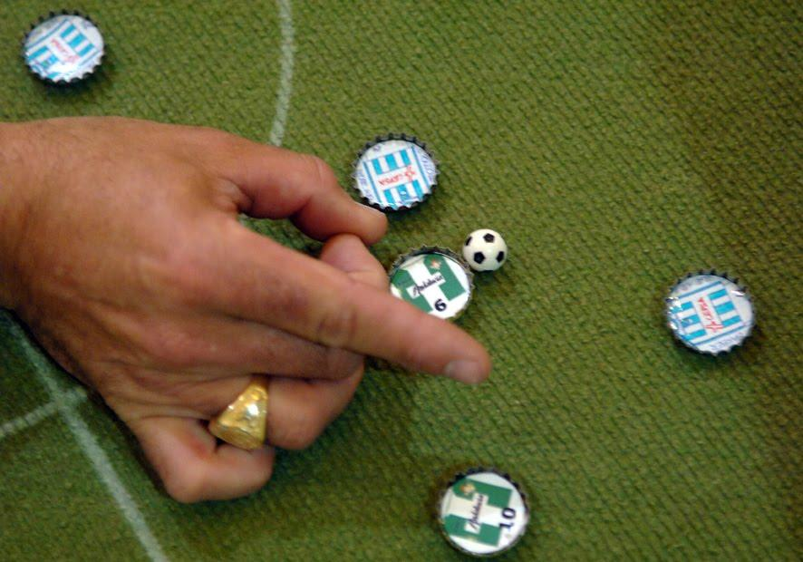
        &lt;text weight="medium" size="xs"&gt;2. Flick&lt;/text&gt;
        &lt;text color="secondary" size="2xs"&gt;Hand animation plays&lt;/text&gt;
      &lt;/grid-item&gt;
      &lt;grid-item&gt;
        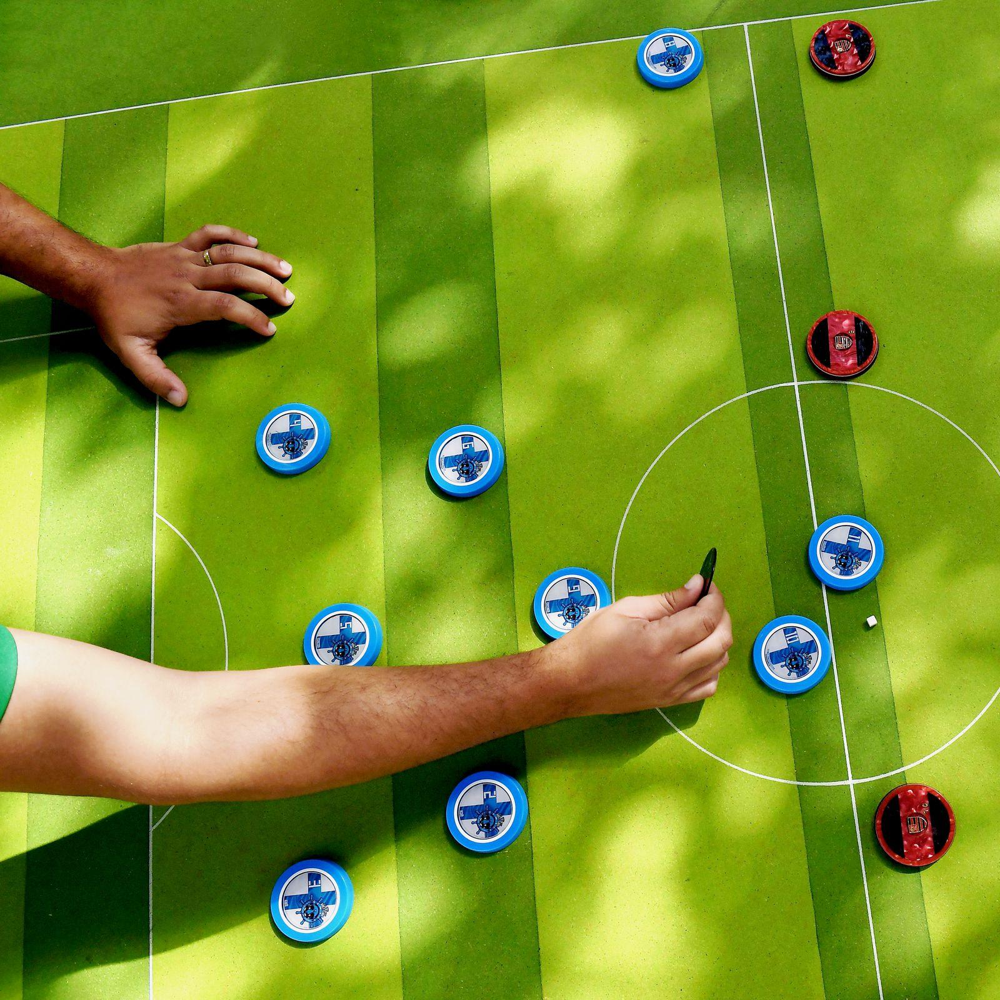
        &lt;text weight="medium" size="xs"&gt;3. Follow&lt;/text&gt;
        &lt;text color="secondary" size="2xs"&gt;Camera tracks the shot&lt;/text&gt;
      &lt;/grid-item&gt;
    &lt;/grid&gt;
  &lt;/box&gt;
&lt;/box&gt;

The proposed camera sequence:

1. Player aims from their chosen camera angle.
2. On release, camera transitions toward the selected counter.
3. A short hand/finger flick animation plays as the impulse is applied.
4. Camera follows the moving counter and button.
5. When everything settles, camera returns to the player's preferred view.

Babylon's animation system and camera controls can handle this without requiring a separate animation framework.

Crucially, the cinematic should be **skippable or disableable**, since repeated animations can become frustrating during long matches.

## 3. Camera freedom

We'll support three things initially:

- **Orbit:** Drag to rotate around the tabletop.
- **Zoom:** Mouse wheel or pinch gesture.
- **Reset:** Return to the default elevated view.

Plus the cinematic shot camera, which temporarily takes control during flick playback.

I'd preserve the player's chosen camera position between turns instead of resetting it automatically every time.

## 4. MVP technical architecture

&lt;box border radius="lg" padding={3} gap={2}&gt;
  &lt;box align="center" gap={1}&gt;
    &lt;box background="surface-secondary" padding={3} radius="md" width="100%" align="center"&gt;
      **Babylon.js + TypeScript**

      &lt;text color="secondary" size="xs"&gt;Scene · Rendering · Cameras · Animation · Input&lt;/text&gt;
    &lt;/box&gt;
    &lt;icon name="arrow-down" color="tertiary"/&gt;
    &lt;grid columns={2} gap={2}&gt;
      &lt;grid-item&gt;
        &lt;box background="surface-secondary" radius="md" padding={3} align="center"&gt;
          **Havok Physics**

          &lt;text color="secondary" size="2xs"&gt;Caps, button, collisions&lt;/text&gt;
        &lt;/box&gt;
      &lt;/grid-item&gt;
      &lt;grid-item&gt;
        &lt;box background="surface-secondary" radius="md" padding={3} align="center"&gt;
          **Game Logic**

          &lt;text color="secondary" size="2xs"&gt;Turns, fouls, goals, scoring&lt;/text&gt;
        &lt;/box&gt;
      &lt;/grid-item&gt;
    &lt;/grid&gt;
    &lt;icon name="arrow-down" color="tertiary"/&gt;
    &lt;box background="surface-secondary" padding={3} radius="md" width="100%" align="center"&gt;
      **UI Layer**

      &lt;text color="secondary" size="xs"&gt;Scoreboard · Menus · Controls · Shot feedback&lt;/text&gt;
    &lt;/box&gt;
  &lt;/box&gt;
&lt;/box&gt;

We don't need a backend for the first playable prototype. We can start with local two-player gameplay and add multiplayer after the core game feels right.

## 5. What we're deliberately postponing

Leaderboard, ranked matchmaking, larger boards, custom counter designs, adjustable counter weights, progression systems and Korre-wide social features.

The architecture shouldn't prevent these later, but none should slow down the first release.

## 6. Immediate development milestones

&lt;box gap={2}&gt;
  {#each [
    ["01","Physical board","Wooden table, football pitch, goals, counters and button"],
    ["02","Physics","Flick impulses, sliding friction, counter collisions and realistic settling"],
    ["03","Game rules","Alternating turns, fouls, extra turns, goals and victory"],
    ["04","Camera system","Orbit, zoom, reset and cinematic flick playback"],
    ["05","Game presentation","Hand animation, sounds, scoreboard, menus and polish"]
  ] as item}
    &lt;row align="start" gap={3}&gt;
      &lt;box background="surface-secondary" radius="md" padding={2}&gt;
        &lt;text color="secondary" weight="medium" tabularNums&gt;{item[0]}&lt;/text&gt;
      &lt;/box&gt;
      &lt;box flex="1" gap={1}&gt;
        **{item[1]}**
        &lt;text color="secondary" size="sm"&gt;{item[2]}&lt;/text&gt;
      &lt;/box&gt;
    &lt;/row&gt;
  {/each}
&lt;/box&gt;

One thing I'd like to establish before we start building:

**Is the first playable version going to be human vs AI, or two humans sharing one device?**

I ask because the reference screenshot includes AI vs AI, but implementing a genuinely enjoyable opponent is a separate problem from getting the physics right. My preference would be local two-player first, then AI, then online multiplayer.

---

<a id="message-07"></a>

## Message 07 — User

2026-10-09 19:04:20 UTC+01:00 · Message ID: `5a278de4-ca48-4a58-8390-df0dda9b73f5`

it's going to be both, we're going to have human vs ai and then human vs human playing against each other (multi-player)...the multiplayer infra we will build will have to be foundational (from korre, don't you think?)...

part of what we're going to build in korre eventually is a ai native game-ish harness based on kraddle (hopefully) so people will build their own games easily and bring it to korre for others to play...jsyk

do we need to go into the design style and what not???

I would like execution to be very abstraction focused (I think babylon makes that easy).

I like this, let's clear out all the open decisions left to be made

---

<a id="message-08"></a>

## Message 08 — Assistant

2026-10-09 19:04:23 UTC+01:00 · Message ID: `3f571d7c-6995-4db6-b338-f6e73a7b9a50`

Yes. **Korre should own the multiplayer infrastructure, while Counters should own its gameplay.** And given your plans for Kraddle, I'd take abstraction seriously from day one.

But there's an important distinction: we should build **reusable contracts now, not an entire generalized game engine**. Babylon already handles much of the engine work.

We can settle almost every remaining decision before writing code.

## 1. Proposed architecture

&lt;box border radius="lg" padding={3} gap={2}&gt;
  &lt;box align="center" gap={1}&gt;
    &lt;box background="surface-secondary" padding={3} radius="md" width="100%" align="center"&gt;
      **Korre Platform**

      &lt;text color="secondary" size="xs"&gt;Identity · Game catalog · Sessions · Matchmaking · Multiplayer&lt;/text&gt;
    &lt;/box&gt;
    &lt;icon name="arrow-down" color="tertiary"/&gt;
    &lt;box background="rgba(35,131,226,0.08)" border={{size:1,color:"rgba(35,131,226,0.25)"}} radius="md" padding={3} width="100%" align="center"&gt;
      **Korre Game SDK**

      &lt;text color="secondary" size="xs"&gt;Game lifecycle · Inputs · State sync · Players · Events&lt;/text&gt;
    &lt;/box&gt;
    &lt;icon name="arrow-down" color="tertiary"/&gt;
    &lt;box background="surface-secondary" padding={3} radius="md" width="100%" align="center"&gt;
      **Counters**

      &lt;text color="secondary" size="xs"&gt;Rules · Board · Flicking · AI · Camera · Assets&lt;/text&gt;
    &lt;/box&gt;
    &lt;icon name="arrow-down" color="tertiary"/&gt;
    &lt;grid columns={2} gap={2}&gt;
      &lt;grid-item&gt;
        &lt;box background="surface-secondary" padding={3} radius="md" align="center"&gt;
          **Babylon.js**

          &lt;text color="secondary" size="2xs"&gt;Rendering and animation&lt;/text&gt;
        &lt;/box&gt;
      &lt;/grid-item&gt;
      &lt;grid-item&gt;
        &lt;box background="surface-secondary" padding={3} radius="md" align="center"&gt;
          **Havok**

          &lt;text color="secondary" size="2xs"&gt;Physics simulation&lt;/text&gt;
        &lt;/box&gt;
      &lt;/grid-item&gt;
    &lt;/grid&gt;
  &lt;/box&gt;
&lt;/box&gt;

The key architectural boundary is this:

**A game submits actions, the authoritative simulation determines outcomes, and clients render those outcomes.**

For Counters, an action might contain the selected counter, flick direction and impulse strength.

The server validates the action, advances the physics simulation, resolves collisions and fouls, then distributes the resulting state.

This also gives us a clean foundation for AI opponents, replays, spectators and multiplayer.

### My proposed technical decisions

| Area | Decision |
|---|---|
| Language | TypeScript |
| 3D engine | Babylon.js |
| Physics | Havok |
| Game state | Framework-independent TypeScript |
| Multiplayer | Authoritative server |
| Transport | WebSockets |
| Runtime | Node.js initially |
| Deployment | Cloudflare-compatible architecture where practical |
| Frontend UI | React for menus/HUD, Babylon for 3D |
| AI opponent | Heuristic shot evaluation + physics simulation |
| Game integration | Engine-agnostic Korre SDK |

One nuance: Havok simulation across different machines should not be assumed deterministic. For multiplayer, clients should receive authoritative outcomes rather than independently trusting their simulations to remain synchronized.

For the future Kraddle-based creation system, I'd eventually give generated games a manifest and SDK contract. That allows Korre to host Babylon, Three.js, Phaser or other web games without forcing creators into one engine.

## 2. Design style: yes, but only enough to execute

We don't need an extensive brand identity exercise yet.

We need to define two separate visual systems.

&lt;box gap={3}&gt;
  &lt;row align="start" gap={3}&gt;
    
    &lt;box flex="1" gap={1}&gt;
      **Counters: Physical realism**

      Wood, green pitch, metallic bottle caps, cloth button, tactile collisions, natural shadows and restrained effects.

      The objects should feel like real objects.
    &lt;/box&gt;
  &lt;/row&gt;
  &lt;divider color="subtle"/&gt;
  &lt;row align="start" gap={3}&gt;
    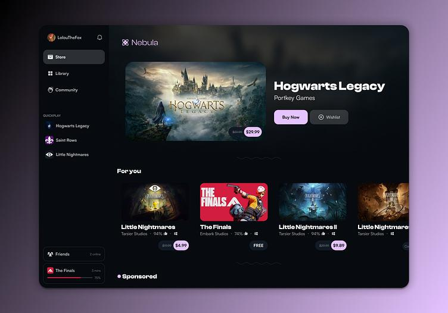
    &lt;box flex="1" gap={1}&gt;
      **Korre: Platform identity**

      A distinct interface system for menus, matchmaking, profiles, settings and game discovery.

      This can evolve independently of each game's art direction.
    &lt;/box&gt;
  &lt;/row&gt;
&lt;/box&gt;

For the first release, I'd use the reference game's appearance as the baseline, then improve lighting, material quality, camera movement and interaction feedback.

## 3. Remaining decisions

Here are the choices that materially affect the MVP. I've preselected my recommendations.

{@body const [multi,setMulti] = DIL.useState("online")}
{@body const [identity,setIdentity] = DIL.useState("guest")}
{@body const [ai,setAi] = DIL.useState("basic")}
{@body const [match,setMatch] = DIL.useState("modes")}
{@body const [physics,setPhysics] = DIL.useState("server")}
{@body const [visual,setVisual] = DIL.useState("reference")}
{@body const [camera,setCamera] = DIL.useState("cinematic")}
{@body const [assets,setAssets] = DIL.useState("procedural")}
{@body const [foul,setFoul] = DIL.useState("first")}
{@body const [bonus,setBonus] = DIL.useState("credits")}
{@body const [edge,setEdge] = DIL.useState("walls")}
{@body const [other,setOther] = DIL.useState("")}
&lt;box border radius="xl" padding={3} gap={3}&gt;
  &lt;box gap={1}&gt;
    &lt;title size="lg"&gt;Match & multiplayer&lt;/title&gt;
    &lt;text color="secondary" size="xs"&gt;How people enter and play games&lt;/text&gt;
  &lt;/box&gt;
  &lt;box gap={2}&gt;
    &lt;text weight="medium" size="sm"&gt;1. Multiplayer launch scope&lt;/text&gt;
    &lt;radio-group direction="col" value={multi} onChange={setMulti}&gt;
      &lt;radio value="online"&gt;Online private rooms + matchmaking&lt;/radio&gt;
      &lt;radio value="private"&gt;Private rooms only initially&lt;/radio&gt;
      &lt;radio value="all"&gt;Online + same-device local play&lt;/radio&gt;
    &lt;/radio-group&gt;
  &lt;/box&gt;
  &lt;box gap={2}&gt;
    &lt;text weight="medium" size="sm"&gt;2. Player identity&lt;/text&gt;
    &lt;radio-group direction="col" value={identity} onChange={setIdentity}&gt;
      &lt;radio value="guest"&gt;Guest play, optional account&lt;/radio&gt;
      &lt;radio value="required"&gt;Account required for multiplayer&lt;/radio&gt;
    &lt;/radio-group&gt;
  &lt;/box&gt;
  &lt;box gap={2}&gt;
    &lt;text weight="medium" size="sm"&gt;3. AI opponent&lt;/text&gt;
    &lt;radio-group direction="col" value={ai} onChange={setAi}&gt;
      &lt;radio value="basic"&gt;Three difficulty levels&lt;/radio&gt;
      &lt;radio value="simple"&gt;One difficulty initially&lt;/radio&gt;
      &lt;radio value="adaptive"&gt;Adaptive AI difficulty&lt;/radio&gt;
    &lt;/radio-group&gt;
  &lt;/box&gt;
  &lt;box gap={2}&gt;
    &lt;text weight="medium" size="sm"&gt;4. Match format&lt;/text&gt;
    &lt;radio-group direction="col" value={match} onChange={setMatch}&gt;
      &lt;radio value="modes"&gt;Casual first-to-3, configurable private matches&lt;/radio&gt;
      &lt;radio value="fixed"&gt;Every match first-to-3&lt;/radio&gt;
    &lt;/radio-group&gt;
  &lt;/box&gt;
  &lt;divider color="subtle"/&gt;
  &lt;box gap={1}&gt;
    &lt;title size="lg"&gt;Simulation & presentation&lt;/title&gt;
    &lt;text color="secondary" size="xs"&gt;How the game behaves and feels&lt;/text&gt;
  &lt;/box&gt;
  &lt;box gap={2}&gt;
    &lt;text weight="medium" size="sm"&gt;5. Physics authority&lt;/text&gt;
    &lt;radio-group direction="col" value={physics} onChange={setPhysics}&gt;
      &lt;radio value="server"&gt;Server-authoritative, including AI matches&lt;/radio&gt;
      &lt;radio value="hybrid"&gt;Local AI matches, authoritative online matches&lt;/radio&gt;
    &lt;/radio-group&gt;
  &lt;/box&gt;
  &lt;box gap={2}&gt;
    &lt;text weight="medium" size="sm"&gt;6. Initial art direction&lt;/text&gt;
    &lt;radio-group direction="col" value={visual} onChange={setVisual}&gt;
      &lt;radio value="reference"&gt;Closely replicate the reference&lt;/radio&gt;
      &lt;radio value="polished"&gt;More polished and photorealistic from day one&lt;/radio&gt;
      &lt;radio value="stylized"&gt;Stylized, playful 3D&lt;/radio&gt;
    &lt;/radio-group&gt;
  &lt;/box&gt;
  &lt;box gap={2}&gt;
    &lt;text weight="medium" size="sm"&gt;7. Flick cinematics&lt;/text&gt;
    &lt;radio-group direction="col" value={camera} onChange={setCamera}&gt;
      &lt;radio value="cinematic"&gt;On by default, with skip and disable options&lt;/radio&gt;
      &lt;radio value="short"&gt;Short cinematic only for significant shots&lt;/radio&gt;
    &lt;/radio-group&gt;
  &lt;/box&gt;
  &lt;box gap={2}&gt;
    &lt;text weight="medium" size="sm"&gt;8. Asset production&lt;/text&gt;
    &lt;radio-group direction="col" value={assets} onChange={setAssets}&gt;
      &lt;radio value="procedural"&gt;Procedural board/caps + imported hand model&lt;/radio&gt;
      &lt;radio value="models"&gt;Model most assets externally&lt;/radio&gt;
    &lt;/radio-group&gt;
  &lt;/box&gt;
  &lt;divider color="subtle"/&gt;
  &lt;box gap={1}&gt;
    &lt;title size="lg"&gt;Rule ambiguities&lt;/title&gt;
    &lt;text color="secondary" size="xs"&gt;Details that need to match the childhood game&lt;/text&gt;
  &lt;/box&gt;
  &lt;box gap={2}&gt;
    &lt;text weight="medium" size="sm"&gt;9. A cap hits an opponent's cap, then the button&lt;/text&gt;
    &lt;radio-group direction="col" value={foul} onChange={setFoul}&gt;
      &lt;radio value="first"&gt;Foul: the button must be contacted first&lt;/radio&gt;
      &lt;radio value="any"&gt;No foul if the button is eventually contacted&lt;/radio&gt;
    &lt;/radio-group&gt;
  &lt;/box&gt;
  &lt;box gap={2}&gt;
    &lt;text weight="medium" size="sm"&gt;10. How do the two bonus flicks work?&lt;/text&gt;
    &lt;radio-group direction="col" value={bonus} onChange={setBonus}&gt;
      &lt;radio value="credits"&gt;Offended player gets two consecutive turns&lt;/radio&gt;
      &lt;radio value="extra"&gt;Offended player gets one extra turn after their normal turn&lt;/radio&gt;
    &lt;/radio-group&gt;
  &lt;/box&gt;
  &lt;box gap={2}&gt;
    &lt;text weight="medium" size="sm"&gt;11. What happens at the pitch edges?&lt;/text&gt;
    &lt;radio-group direction="col" value={edge} onChange={setEdge}&gt;
      &lt;radio value="walls"&gt;Physical barriers keep objects on the board&lt;/radio&gt;
      &lt;radio value="reset"&gt;Objects can leave the board and are repositioned&lt;/radio&gt;
    &lt;/radio-group&gt;
  &lt;/box&gt;
  &lt;box gap={1}&gt;
    &lt;text weight="medium" size="sm"&gt;Anything else about the original game?&lt;/text&gt;
    &lt;textarea rows={2} value={other} onChange={setOther} placeholder="Optional: rules, visuals or behaviors we missed"/&gt;
  &lt;/box&gt;
  &lt;button block onClick={()=&gt;GenUI.issueNewTurn("Finalize the Korre Counters MVP decisions. Multiplayer: "+multi+". Identity: "+identity+". AI: "+ai+". Match format: "+match+". Physics: "+physics+". Visuals: "+visual+". Cinematics: "+camera+". Assets: "+assets+". Foul rule: "+foul+". Bonus turns: "+bonus+". Pitch edges: "+edge+". Additional notes: "+(other||"None")+". Summarize the locked decisions, flag only truly unresolved issues, and prepare us for implementation.")}&gt;Finalize decisions &lt;icon name="arrow-right" inline/&gt;&lt;/button&gt;
&lt;/box&gt;

## 4. How I'd organize the codebase

```text
korre/
├── apps/
│   ├── web/                 # Korre website
│   └── game-server/         # Match authority
├── packages/
│   ├── game-sdk/            # Creator-facing contracts
│   ├── multiplayer/         # Sessions, transport, sync
│   ├── game-protocol/       # Actions, events, schemas
│   └── ui/                  # Shared platform UI
└── games/
    └── counters/
        ├── core/            # Rules and game state
        ├── simulation/      # Havok physics
        ├── renderer/        # Babylon scene
        ├── input/           # Flick interactions
        ├── camera/          # Orbit and cinematics
        ├── ai/              # AI opponent
        └── assets/
```

One thing I'd explicitly avoid is building a universal abstraction for rendering, physics or AI immediately. The Korre SDK should abstract **what a game needs from the platform**, not how a game internally works.

That distinction will be important when Kraddle starts generating games.

Once these decisions are settled, we can move directly to an implementation-ready specification and build Counters vertically, starting with one complete playable flick rather than building all the infrastructure first.

---

<a id="message-09"></a>

## Message 09 — User

2026-10-09 19:41:10 UTC+01:00 · Message ID: `977055d8-9359-43b4-976c-618a223d70e2`

Finalize the Korre Counters MVP decisions. Multiplayer: online. Identity: guest. AI: basic. Match format: modes. Physics: hybrid. Visuals: reference. Cinematics: cinematic. Assets: procedural. Foul rule: any. Bonus turns: extra. Pitch edges: walls. Additional notes: 
1. you should be able to come with your friend(s) emails or usernames list and you guys play together
2. You can't really be a guest player, just pick a unique username and continue, tho you can enter email but it'll be optional...
...
...
6. I mean, let's go with the most light weight option that's still very good (I want it to run fine on mobile browsers)...and then also something about UX writing, the copy used across board should be cultural to nigeria pls, that's very very important.
...
9. 

see my prompt for more:


```
1. nice I agree totally...and for the non-deterministic physics engine, does that mean we'd have to compute the end result of the action and then send the result to both players? (tho we can skip this for human - ai incase it's computationally expensive)
2. counters: they should be 7up, pepsi, fanta...etc popular nigerian beverages, preferably the oldies (the sense of nostalgia will help with user retention), the counter top should be wooden, I would also like to experiment with a boundless concrete option, so you have to ensure the ball(button) doesn't slip out of the bounds (this adds complexity I know, because if it goes out, your opponent gets a throw "position the button at an angle against their counter allowing the button to go over other counters"...this is the same way penalties are played, penalties are fouls inside your "18" against the opponent, kinda like football), I'm just remembering these and I think we should add them...yk what instead of a closed wooden box like that guy did, let's make it green concrete (with visual texture) and the button should be able to fall out)...it should also be larger.
3. ..
4. I actually agree, I'd like the codebase to be feature first rather than layer first (if that's okay) I ALWAYS work with feature first, generally going for modularity, such that each feature would have the same layer skeleton (if they dont' need a layer they shouldn't have it, but if they do it follows that), basically clean archtecture...if it's an overkill let me know
```
. Summarize the locked decisions, flag only truly unresolved issues, and prepare us for implementation.

---

<a id="message-10"></a>

## Message 10 — Assistant

2026-10-09 19:41:12 UTC+01:00 · Message ID: `670f5428-00f4-45e8-bb4b-5dd0487012bf`

# Korre Counters: Finalized MVP v1.0

We now have enough decisions to begin implementation. The major change is that we're no longer replicating the reference game's enclosed wooden tabletop. We're recreating the **Nigerian childhood Counters experience**, using the reference game as our starting point for mechanics and interaction.

I'd lock the following architecture and product decisions.

## 1. Final product decisions

| Area | Decision |
|---|---|
| Platform | Web-first, desktop and mobile browsers |
| Engine | Babylon.js + Havok physics |
| Gameplay | Turn-based, realistic flick physics |
| Game modes | Human vs AI, online Human vs Human |
| AI | Three difficulty levels |
| Multiplayer | Korre-owned, server-authoritative |
| Accounts | Unique username required, email optional |
| Social | Invite friends by username or email |
| Match format | First to 3 goals by default, configurable private matches |
| Art direction | Nostalgic Nigerian Counters |
| Board | Large, open, textured green concrete |
| Counters | Nigerian beverage bottle caps |
| Button | Cloth button, physically simulated |
| Camera | Free orbit, zoom, cinematic flick playback |
| Interface | Mobile-first, Nigerian cultural voice |
| Codebase | Feature-first, modular TypeScript |
| Monetization | Free to play |

The previous decision to use physical walls is superseded by your latest direction: **the button can leave the playing surface**.

## 2. Updated gameplay rules

These are now the baseline rules:

- Players can flick any counter they own, including purely to reposition it.
- Players alternate turns.
- Hitting an opponent's counter without contacting the button during that shot is a foul.
- A foul awards the offended player an additional turn alongside their normal turn.
- A foul committed inside the defending team's penalty area awards a penalty.
- When the button leaves the playing area, the opponent receives a throw-in.
- Throw-ins and penalties use the special button-against-counter positioning mechanic you described.
- First player to score 3 goals wins by default.

We should implement **fouls, penalties and throw-ins as separate rule modules**, not special cases scattered through the physics code.

That will make future game variants much easier.

## 3. Physics and multiplayer

Your understanding is correct.

For online multiplayer:

&lt;box border radius="lg" padding={3} gap={2}&gt;
  &lt;box align="center" gap={1}&gt;
    &lt;box background="surface-secondary" padding={3} radius="md" width="100%" align="center"&gt;
      **Player A flicks**

      &lt;text color="secondary" size="xs"&gt;Counter ID · Direction · Strength · Shot parameters&lt;/text&gt;
    &lt;/box&gt;
    &lt;icon name="arrow-down" color="tertiary"/&gt;
    &lt;box background="surface-secondary" padding={3} radius="md" width="100%" align="center"&gt;
      **Korre Match Server**

      &lt;text color="secondary" size="xs"&gt;Validate action · Simulate physics · Resolve rules&lt;/text&gt;
    &lt;/box&gt;
    &lt;icon name="arrow-down" color="tertiary"/&gt;
    &lt;box background="rgba(35,131,226,0.08)" border={{size:1,color:"rgba(35,131,226,0.25)"}} padding={3} radius="md" width="100%" align="center"&gt;
      **Authoritative shot result**

      &lt;text color="secondary" size="xs"&gt;Object trajectories · Collisions · Goals · Fouls · Next turn&lt;/text&gt;
    &lt;/box&gt;
    &lt;icon name="arrow-down" color="tertiary"/&gt;
    &lt;grid columns={2} gap={2}&gt;
      &lt;grid-item&gt;
        &lt;box background="surface-secondary" radius="md" padding={3} align="center"&gt;
          **Player A**

          &lt;text color="secondary" size="2xs"&gt;Replays the shot&lt;/text&gt;
        &lt;/box&gt;
      &lt;/grid-item&gt;
      &lt;grid-item&gt;
        &lt;box background="surface-secondary" radius="md" padding={3} align="center"&gt;
          **Player B**

          &lt;text color="secondary" size="2xs"&gt;Replays the same shot&lt;/text&gt;
        &lt;/box&gt;
      &lt;/grid-item&gt;
    &lt;/grid&gt;
  &lt;/box&gt;
&lt;/box&gt;

**We do not need to stream the entire simulation continuously.** Since Counters is turn-based, the server can simulate each shot and send a compact, timestamped trajectory or keyframe sequence to both clients.

The clients interpolate the authoritative playback, so both players see the same outcome despite physics nondeterminism.

For Human vs AI, we run physics locally, avoiding server simulation costs. AI opponents can evaluate candidate shots using simplified calculations initially, then refine promising shots through physics simulation.

One important optimization: the server doesn't need to render anything. It only simulates the rigid bodies and game rules.

## 4. Performance: lightweight without sacrificing quality

Babylon.js remains a good choice. I'd use its modular packages rather than the full bundled engine.

| Component | Choice |
|---|---|
| Rendering | Babylon.js WebGL2 first |
| Physics | Havok WASM, lazy-loaded |
| Board | Procedural geometry and tiled textures |
| Counters | Shared meshes with different textures |
| Lighting | Baked/static lighting where possible |
| Shadows | Limited, quality-adjustable |
| Animations | Babylon animation system |
| Mobile | Adaptive resolution and graphics quality |
| Assets | Compressed textures, GLB for hand model |
| Network | WebSockets with compact messages |

I wouldn't prioritize WebGPU yet. WebGL2 provides a more practical compatibility baseline for mobile browsers.

A particularly useful optimization is **instancing**: all bottle caps can share the same underlying geometry while using different materials or texture variations.

The hand model should be loaded only when needed. Cinematic playback can also use a simplified animation on lower-end devices.

**Performance targets:** 60 FPS on capable devices, 30 FPS minimum on supported lower-end devices, with gameplay physics independent of rendering framerate. These are targets to validate on real phones, not guaranteed outcomes.

## 5. Feature-first architecture

Your preferred architecture is appropriate here. The overkill would be imposing a full Clean Architecture stack on every tiny component.

I'd use feature boundaries with optional internal layers.

```text
korre/
├── apps/
│   ├── web/
│   └── match-server/
│
├── packages/
│   ├── game-sdk/
│   ├── multiplayer/
│   ├── identity/
│   └── protocol/
│
└── games/
    └── counters/
        ├── features/
        │   ├── gameplay/
        │   ├── flick/
        │   ├── physics/
        │   ├── referee/
        │   ├── camera/
        │   ├── cinematics/
        │   ├── ai/
        │   ├── multiplayer/
        │   └── match-lobby/
        │
        ├── scene/
        ├── assets/
        └── main.ts
```

Each feature can use:

```text
feature/
├── domain/
├── application/
├── infrastructure/
└── presentation/
```

But only when those layers are useful.

For example, `referee` needs a domain layer containing pure rules, while `camera` might only need a controller and configuration.

### One architectural rule I'd enforce

**Gameplay state must not depend on Babylon scene objects.**

A counter's position, velocity, owner and identity belong to the simulation model. Its Babylon mesh is just a visual representation.

This separation makes the game testable, server-executable, replayable and easier for Kraddle to modify.

## 6. Visual identity and Nigerian UX writing

&lt;box gap={2}&gt;
  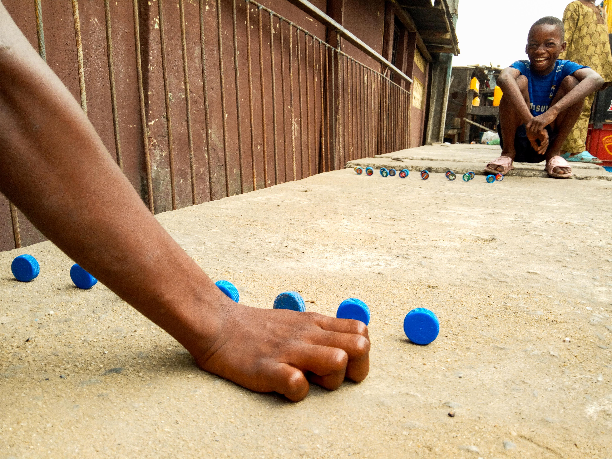

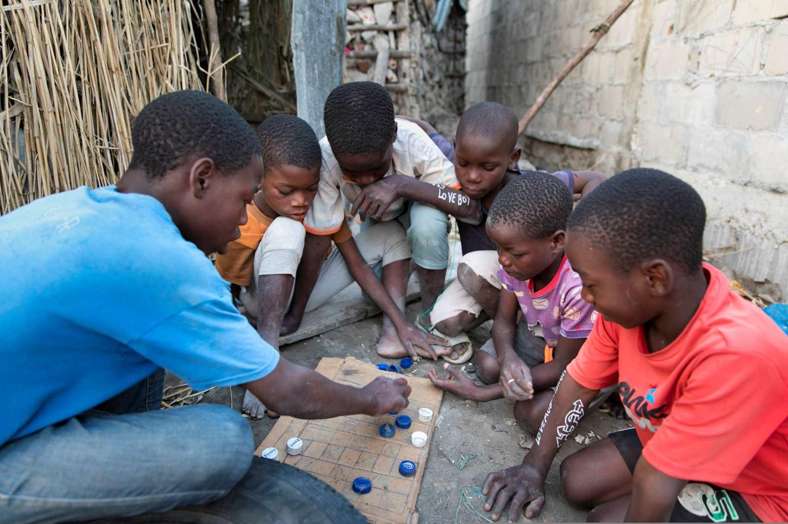

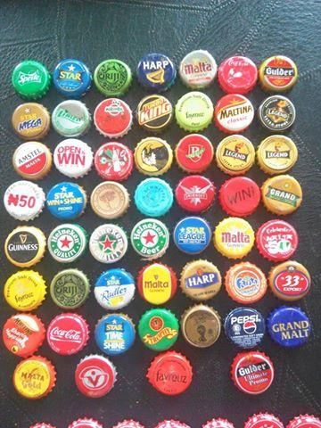

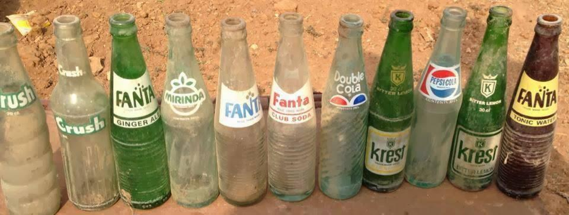


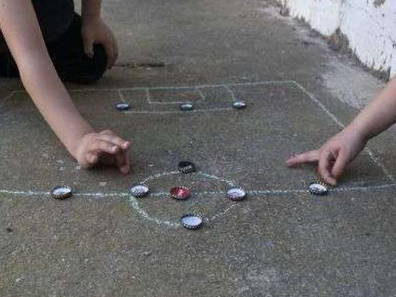

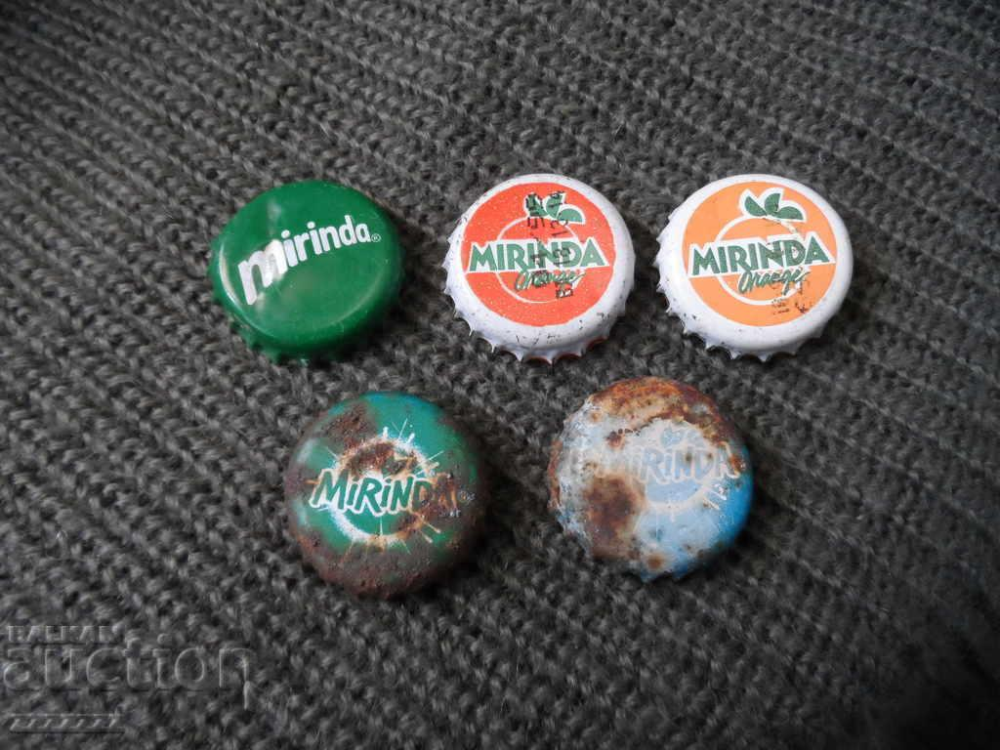
&lt;/box&gt;

I'd pursue **recognizable Nigerian nostalgia without making the interface difficult to understand**.

For example:

| Generic copy | Korre copy |
|---|---|
| Quick Match | Find Match |
| Play with Friends | Run Am with Your Guys |
| Your Turn | Your Turn, Oya! |
| Foul | Foul! You Don Collect Extra Turn |
| Goal | GOOOOAL! |
| Victory | You Carry This One! |
| Rematch | Run Am Back |
| Waiting for opponent | Your Opponent Dey Think... |

The important distinction is that Nigerian cultural writing shouldn't mean putting Pidgin everywhere. It should feel authentic, situational and natural.

I'd create a centralized copy dictionary so we can refine the tone without touching game logic.

For the beverage caps, we can prototype with original, nostalgic-looking designs. Using actual Pepsi, Fanta and 7UP logos publicly may require trademark permissions, so I'd treat authentic branded artwork as an asset-licensing decision rather than an automatic launch requirement.

## 7. Decisions still requiring clarification

Most of the product and technical decisions are settled. These are the remaining gameplay ambiguities.

{@body const [friends,setFriends] = DIL.useState("duel")}
{@body const [penalty,setPenalty] = DIL.useState("inside")}
{@body const [throwin,setThrowin] = DIL.useState("nearest")}
{@body const [foulTurns,setFoulTurns] = DIL.useState("next")}
{@body const [reset,setReset] = DIL.useState("formation")}
{@body const [notes,setNotes] = DIL.useState("")}
&lt;box border radius="xl" padding={3} gap={3}&gt;
  &lt;box gap={2}&gt;
    &lt;text weight="medium"&gt;1. Playing with multiple friends&lt;/text&gt;
    &lt;text color="secondary" size="xs"&gt;When someone invites several usernames or emails, how should they participate?&lt;/text&gt;
    &lt;radio-group direction="col" value={friends} onChange={setFriends}&gt;
      &lt;radio value="duel"&gt;One vs one, others can spectate or queue&lt;/radio&gt;
      &lt;radio value="teams"&gt;Allow multiple people per team, taking turns&lt;/radio&gt;
      &lt;radio value="both"&gt;Support both&lt;/radio&gt;
    &lt;/radio-group&gt;
  &lt;/box&gt;
  &lt;divider color="subtle"/&gt;
  &lt;box gap={2}&gt;
    &lt;text weight="medium"&gt;2. Penalty conditions&lt;/text&gt;
    &lt;radio-group direction="col" value={penalty} onChange={setPenalty}&gt;
      &lt;radio value="inside"&gt;Foul involving a defending counter inside its own penalty area&lt;/radio&gt;
      &lt;radio value="ball"&gt;Button must also be inside the penalty area&lt;/radio&gt;
      &lt;radio value="other"&gt;Another condition, I'll explain&lt;/radio&gt;
    &lt;/radio-group&gt;
  &lt;/box&gt;
  &lt;divider color="subtle"/&gt;
  &lt;box gap={2}&gt;
    &lt;text weight="medium"&gt;3. Throw-in position&lt;/text&gt;
    &lt;radio-group direction="col" value={throwin} onChange={setThrowin}&gt;
      &lt;radio value="nearest"&gt;At the point where the button crossed the boundary&lt;/radio&gt;
      &lt;radio value="free"&gt;Player chooses a position along that boundary&lt;/radio&gt;
      &lt;radio value="custom"&gt;Traditional rule differs&lt;/radio&gt;
    &lt;/radio-group&gt;
  &lt;/box&gt;
  &lt;divider color="subtle"/&gt;
  &lt;box gap={2}&gt;
    &lt;text weight="medium"&gt;4. Foul bonus timing&lt;/text&gt;
    &lt;radio-group direction="col" value={foulTurns} onChange={setFoulTurns}&gt;
      &lt;radio value="next"&gt;Offended player takes the next two flicks consecutively&lt;/radio&gt;
      &lt;radio value="banked"&gt;Offended player gets an extra flick to use later&lt;/radio&gt;
    &lt;/radio-group&gt;
  &lt;/box&gt;
  &lt;divider color="subtle"/&gt;
  &lt;box gap={2}&gt;
    &lt;text weight="medium"&gt;5. After a goal&lt;/text&gt;
    &lt;radio-group direction="col" value={reset} onChange={setReset}&gt;
      &lt;radio value="formation"&gt;Reset all counters to their starting formations&lt;/radio&gt;
      &lt;radio value="button"&gt;Reset only the button, preserving counter positions&lt;/radio&gt;
    &lt;/radio-group&gt;
  &lt;/box&gt;
  &lt;box gap={1}&gt;
    &lt;text weight="medium"&gt;Any other traditional rules or exceptions?&lt;/text&gt;
    &lt;textarea value={notes} onChange={setNotes} rows={3} placeholder="Optional"/&gt;
  &lt;/box&gt;
  &lt;button block onClick={()=&gt;GenUI.issueNewTurn("Complete the remaining Korre Counters decisions: Friends = "+friends+"; penalty conditions = "+penalty+"; throw-in position = "+throwin+"; foul bonus timing = "+foulTurns+"; after-goal reset = "+reset+"; other notes = "+(notes||"none")+". Incorporate them into the final implementation-ready MVP spec.")}&gt;Lock remaining rules &lt;icon name="arrow-right" inline/&gt;&lt;/button&gt;
&lt;/box&gt;

One additional implementation detail can be settled without another decision: for a throw-in or penalty, we can use a dedicated placement state where the button is positioned against an eligible counter and the player adjusts its angle before flicking. The precise placement constraints should follow the traditional rules you confirm.

After these five decisions, the next step is a concrete build specification: data models, state machine, Korre SDK contracts, multiplayer protocol, scene structure and implementation milestones.

**The goal is one complete, playable Counters game built on a small but genuinely reusable Korre foundation, not a prematurely generalized gaming platform.**

---

<a id="message-11"></a>

## Message 11 — User

2026-10-09 23:20:58 UTC+01:00 · Message ID: `d3dd857a-1304-489f-9d13-b50f13a9152c`

Complete the remaining Korre Counters decisions: Friends = duel; penalty conditions = inside; throw-in position = nearest; foul bonus timing = next; after-goal reset = formation; other notes = 1. hmm, I like the idea of spectation a lot, so they can spectate while they wait their turn...hmmm, that gives me the idea of streaming built into korre...again for later. 🙂 but yeah, let's do that, and we can even take that idea of spectating to a nice level where you can invite more people to spectate your game
2. yeah, for a penalty you have to foul your opponent in your own penalty area
3. it's the exact same position, or around it (doesn't really have to be perfect perfect)
4. the foul bonus is immediately, they play an extra turn with their original turn.
5. yes reset them to their formations, also a player can choose their formation, (pick from the standard football formations based on the number of counters used


for the backend stack, cloudflare??? I think cloudflare is just great, workers + DO for realtime, D1 for storage (tho I'm skeptical of sqlite, I would have loved postgres)...perhaps I can just use my oracle OCI for postgres and to run the api server?


6. for the ux writing, Ilike the fact that you're trying not to put pidgin everywhere, but pls ease on it "play with friends" is perfectly fine..."foul! you don collect extra turn" has issues because no one (nigerian) sees it as a "turn" in the first place, so that's cringe. there are elements of that gringe everywhere, (it's the same cringe that made me say "play with friends" is fine).


. Incorporate them into the final implementation-ready MVP spec.

---

<a id="message-12"></a>

## Message 12 — Assistant

2026-10-09 23:21:32 UTC+01:00 · Message ID: `f69c1b52-d4c8-4397-b725-d3e7e81527c3`

# Korre Counters: Implementation Specification v1.0

&lt;badge color="success"&gt;&lt;icon name="check-circle" size="xs" inline/&gt; Product decisions locked&lt;/badge&gt;

We now have a coherent MVP: **a nostalgic Nigerian Counters game, playable against AI or real people, with spectating, configurable formations, realistic physics, and a reusable multiplayer foundation for Korre.**

I'd also make two architectural choices:

1. **Cloudflare Workers + Durable Objects for multiplayer.**
2. **PostgreSQL for persistent data**, potentially hosted on your Oracle Cloud infrastructure.

I wouldn't introduce a conventional always-running API server unless we find a concrete reason to need one.

## 1. Finalized game specification

| Area | Final decision |
|---|---|
| Engine | Babylon.js, modular imports |
| Physics | Havok WASM |
| Platform | Web, mobile-first |
| Board | Large, open, textured green concrete |
| Counters | Nostalgic Nigerian beverage bottle caps |
| Button | Small cloth button |
| Players | 1v1, Human vs AI or online PvP |
| Friends | Invite by username or email |
| Spectating | Friends and invited spectators can watch live |
| Matchmaking | Public casual queue and private rooms |
| Accounts | Unique username required, email optional |
| AI | Easy, Medium, Hard |
| Victory | First to 3 goals, configurable in private matches |
| Formation | Player selects from formations valid for the counter count |
| Camera | Free orbit, zoom and cinematic flick playback |
| Physics authority | Local for AI, server for PvP |
| Style | Faithful physical realism |
| Language | Natural Nigerian English, restrained Pidgin |

### Gameplay rules

- A player can flick any of their counters, even without intending to touch the button.
- Players alternate shots.
- Hitting an opponent's counter without touching the button during the shot is a foul.
- A foul awards the offended player two consecutive shots, including their normal shot.
- Fouling an opponent inside your own penalty area results in a penalty.
- When the button leaves the playing surface, the opponent gets a throw-in at approximately the exit position.
- Throw-ins and penalties allow positioning the button against a counter for a lofted shot.
- Goals reset the button and counters to their starting formations.
- First to the target score wins.

We'll treat the selected formation as part of each player's match configuration, so resets preserve their individual choices.

### A small rule-engine detail

We should explicitly distinguish:

- `normal`: ordinary shot
- `freeKick`: foul restart outside the penalty area, if we decide to implement it
- `penalty`: foul restart inside the penalty area
- `throwIn`: button leaves the field
- `kickoff`: starting or restarting after a goal

These are *game phases*, not merely UI labels. Each can impose different placement and shot constraints.

## 2. Spectating as a Korre primitive

This is worth implementing from the start.

A multiplayer room should have **participants**, not just two player connections.

&lt;box border radius="lg" padding={3} gap={2}&gt;
  &lt;box background="surface-secondary" radius="md" padding={3} align="center" gap={1}&gt;
    **Korre Match Room**

    &lt;text color="secondary" size="xs"&gt;One authoritative simulation&lt;/text&gt;
  &lt;/box&gt;
  &lt;grid columns={2} gap={2}&gt;
    &lt;grid-item&gt;
      &lt;box background="rgba(35,131,226,0.08)" radius="md" padding={3} gap={1}&gt;
        &lt;row align="center" gap={1}&gt;
          &lt;icon name="gamepad-2" color="info"/&gt;
          **Players**
        &lt;/row&gt;
        &lt;text size="xs" color="secondary"&gt;2 active players&lt;/text&gt;
        &lt;text size="xs" color="secondary"&gt;Can submit shots&lt;/text&gt;
      &lt;/box&gt;
    &lt;/grid-item&gt;
    &lt;grid-item&gt;
      &lt;box background="surface-secondary" radius="md" padding={3} gap={1}&gt;
        &lt;row align="center" gap={1}&gt;
          &lt;icon name="eye"/&gt;
          **Spectators**
        &lt;/row&gt;
        &lt;text size="xs" color="secondary"&gt;Multiple viewers&lt;/text&gt;
        &lt;text size="xs" color="secondary"&gt;Read-only state&lt;/text&gt;
      &lt;/box&gt;
    &lt;/grid-item&gt;
  &lt;/grid&gt;
  &lt;box align="center" gap={1}&gt;
    &lt;icon name="arrow-down" color="tertiary"/&gt;
    &lt;box background="surface-secondary" padding={3} radius="md" width="100%" align="center"&gt;
      **Match Event Stream**

      &lt;text color="secondary" size="xs"&gt;Shots · Trajectories · Scores · Fouls · Replays&lt;/text&gt;
    &lt;/box&gt;
  &lt;/box&gt;
&lt;/box&gt;

Spectators receive the same game-state and playback events as players, but cannot submit gameplay actions.

We can add a waiting queue to private rooms. When a match ends, queued friends can be offered the next match, with a short acceptance window.

Importantly, **spectating does not require video streaming**. We're distributing game state, and each spectator's browser renders the game locally.

That makes it dramatically cheaper than streaming rendered video and provides a foundation for Korre's eventual live-game experiences.

## 3. Backend architecture: Cloudflare + Oracle PostgreSQL

I'd choose the hybrid approach, with Cloudflare handling HTTP APIs and realtime sessions, and Oracle hosting PostgreSQL.

&lt;box border radius="lg" padding={3} gap={2}&gt;
  &lt;box align="center" gap={1}&gt;
    &lt;box background="surface-secondary" padding={3} radius="md" width="100%" align="center"&gt;
      **Korre Web Client**

      &lt;text color="secondary" size="xs"&gt;Babylon.js · React · Game SDK&lt;/text&gt;
    &lt;/box&gt;
    &lt;icon name="arrow-down" color="tertiary"/&gt;
    &lt;box background="rgba(35,131,226,0.08)" border={{size:1,color:"rgba(35,131,226,0.25)"}} radius="md" padding={3} width="100%" align="center"&gt;
      **Cloudflare Workers**

      &lt;text color="secondary" size="xs"&gt;API · Identity · Matchmaking · Invitations&lt;/text&gt;
    &lt;/box&gt;
    &lt;grid columns={2} gap={2}&gt;
      &lt;grid-item&gt;
        &lt;box align="center" gap={1}&gt;
          &lt;icon name="arrow-down" color="tertiary"/&gt;
          &lt;box background="surface-secondary" padding={3} radius="md" width="100%" align="center" gap={1}&gt;
            **Durable Objects**

            &lt;text color="secondary" size="2xs" textAlign="center"&gt;Match rooms · WebSockets · Turn authority · Spectators&lt;/text&gt;
          &lt;/box&gt;
        &lt;/box&gt;
      &lt;/grid-item&gt;
      &lt;grid-item&gt;
        &lt;box align="center" gap={1}&gt;
          &lt;icon name="arrow-down" color="tertiary"/&gt;
          &lt;box background="surface-secondary" padding={3} radius="md" width="100%" align="center" gap={1}&gt;
            **Hyperdrive**

            &lt;text color="secondary" size="2xs" textAlign="center"&gt;PostgreSQL connection pooling&lt;/text&gt;
          &lt;/box&gt;
          &lt;icon name="arrow-down" color="tertiary"/&gt;
          &lt;box background="surface-secondary" padding={3} radius="md" width="100%" align="center" gap={1}&gt;
            **OCI PostgreSQL**

            &lt;text color="secondary" size="2xs" textAlign="center"&gt;Users · Friends · Matches · Invitations&lt;/text&gt;
          &lt;/box&gt;
        &lt;/box&gt;
      &lt;/grid-item&gt;
    &lt;/grid&gt;
  &lt;/box&gt;
&lt;/box&gt;

Cloudflare Hyperdrive supports external PostgreSQL databases and provides connection pooling for Workers. That means you can keep PostgreSQL on OCI without maintaining an API server just to access it.  [Source 1](https://developers.cloudflare.com/hyperdrive/get-started/), [Source 2](https://developers.cloudflare.com/hyperdrive/examples/connect-to-postgres/?ref=blog.cloudflare.com).

### Why not D1?

D1 isn't inherently a bad choice. SQLite is perfectly capable of handling many production workloads.

But PostgreSQL is reasonable here because you're anticipating social relationships, matchmaking, identity and eventually multiple games.

I'd use:

- **PostgreSQL:** Persistent platform records.
- **Durable Object SQLite storage:** Room checkpoints, reconnect state and pending actions.
- **Durable Object memory:** Active participants and transient simulation state.
- **R2:** Static game assets and future user-generated content.

Durable Objects provide strongly consistent storage scoped to each object, so a match room can recover its own state independently.  [Source 1](https://developers.cloudflare.com/durable-objects/api/sqlite-storage-api/).

### Important limitation: Havok on Workers

I would **not assume Havok WASM can run efficiently inside Durable Objects** without benchmarking.

A DO can own a match's state and WebSocket connections, but server-side physics may be computationally expensive or run into runtime constraints.

Therefore, we'll introduce a `SimulationRunner` interface with two implementations:

- `LocalSimulationRunner`: Browser-side Havok for AI matches.
- `AuthoritativeSimulationRunner`: Server-side simulation for PvP.

The authoritative runner can initially run inside a Durable Object if testing confirms it is viable. Otherwise, we can execute physics on OCI while keeping the Durable Object as the room coordinator.

This is one abstraction worth building immediately because it protects the rest of the architecture from a potentially expensive infrastructure change.

Also, use Cloudflare's WebSocket Hibernation API for idle rooms. It can preserve connections without continuously billing active compute duration.  [Source 1](https://github.com/cloudflare/cloudflare-docs/blob/production/src/content/docs/durable-objects/best-practices/websockets.mdx), [Source 2](https://developers.cloudflare.com/durable-objects/platform/pricing/).

## 4. Identity and invitations

You're right to reject the term *guest*. Everyone is a Korre player.

### Onboarding

&lt;box border radius="lg" padding={3} gap={3}&gt;
  &lt;box gap={1}&gt;
    &lt;title size="lg"&gt;Welcome to Korre&lt;/title&gt;
    &lt;text color="secondary" size="sm"&gt;Pick a username and start playing.&lt;/text&gt;
  &lt;/box&gt;
  &lt;box gap={1}&gt;
    &lt;label&gt;Username&lt;/label&gt;
    &lt;input placeholder="e.g. dartgod" disabled/&gt;
  &lt;/box&gt;
  &lt;box gap={1}&gt;
    &lt;label&gt;Email (optional)&lt;/label&gt;
    &lt;input placeholder="you@example.com" disabled/&gt;
  &lt;/box&gt;
  &lt;button block disabled&gt;Start playing &lt;icon name="arrow-right" inline/&gt;&lt;/button&gt;
  &lt;caption&gt;Illustrative onboarding layout, not an active signup form.&lt;/caption&gt;
&lt;/box&gt;

A unique username creates a lightweight player identity.

However, **username-only onboarding needs an account-recovery strategy**. Otherwise, clearing browser data or switching devices could permanently disconnect someone from their identity.

My recommendation:

- Create an anonymous authenticated session linked to the username.
- Persist the session securely on the device.
- Allow players to attach a verified email later.
- Require stronger account verification for sensitive actions or account recovery.

An email invitation to an unregistered player becomes a pending invite associated with that address, redeemable after email verification.

### Friends and spectators

A room can have:

- Two active player slots.
- Multiple spectator slots.
- A waiting queue.
- A shareable invite link.
- Username invitations and email invitations.

For MVP, I'd support spectating and queueing, but defer video streaming, spectator chat and public discovery of live matches.

## 5. Data models and protocol

The initial persistent data model can stay small.

| Model | Essential fields |
|---|---|
| Player | ID, username, email?, createdAt |
| PlayerSession | ID, playerId, expiry, revokedAt |
| Match | ID, gameId, mode, status, winnerId? |
| MatchParticipant | MatchId, playerId, role, slot |
| MatchInvitation | MatchId, recipient, status, token |
| MatchResult | MatchId, score, winner, completedAt |
| PlayerPreferences | PlayerId, camera, graphics, formation |

We can add a `GameManifest` contract early:

```ts
interface GameManifest {
  id: string;
  version: string;
  name: string;
  minPlayers: number;
  maxPlayers: number;
  supportsSpectators: boolean;
  supportedModes: ("solo" | "ai" | "pvp")[];
}
```

This is intentionally engine-agnostic.

### Multiplayer protocol

```ts
type ClientAction =
  | { type: "match.join"; matchId: string }
  | { type: "match.spectate"; matchId: string }
  | {
      type: "game.action";
      matchId: string;
      actionId: string;
      expectedVersion: number;
      payload: unknown;
    };

type ServerEvent =
  | { type: "match.snapshot"; state: unknown }
  | { type: "game.action.accepted"; actionId: string }
  | { type: "game.action.rejected"; reason: string }
  | { type: "game.playback"; frames: unknown }
  | { type: "match.completed"; result: unknown };
```

The protocol needs versioning, authentication, reconnection and idempotent action handling. A reconnecting player should receive a fresh snapshot rather than relying on missed events being replayed indefinitely.

For Counters specifically, the shot payload should include counter ID, normalized aim vector, impulse strength and the active restart context.

The server validates ownership, active player, shot legality and state version before executing it.

## 6. Feature-first project structure

I'd organize the repository around independently understandable features, with the shared Korre packages kept deliberately small.

```text
korre/
├── apps/
│   ├── web/
│   └── api/                   # Cloudflare Worker
│
├── packages/
│   ├── game-sdk/
│   ├── game-protocol/
│   ├── multiplayer/
│   ├── identity/
│   └── ui/
│
├── games/
│   └── counters/
│       ├── features/
│       │   ├── match/
│       │   ├── flick/
│       │   ├── referee/
│       │   ├── formations/
│       │   ├── restarts/
│       │   ├── ai/
│       │   ├── camera/
│       │   └── cinematics/
│       ├── simulation/
│       ├── scene/
│       ├── assets/
│       └── index.ts
│
└── infrastructure/
    ├── cloudflare/
    └── database/
```

Within each feature, use `domain`, `application`, `infrastructure` and `presentation` only where the complexity justifies them.

Two rules are especially important:

1. **No Babylon.js dependencies in domain rules.** Rules should be testable without rendering anything.
2. **No Korre-specific backend dependencies inside Counters gameplay.** Platform integration happens through SDK interfaces.

This gives Kraddle a future path to generate or modify individual game features without having to understand the entire Korre infrastructure.

## 7. UX writing: Nigerian, not performatively Nigerian

Your correction is valid. The previous examples sounded like English UI strings translated into Pidgin rather than language people would naturally use while playing.

I'd establish this writing principle:

**Use ordinary English for functionality. Use Nigerian cultural language only where it genuinely adds personality.**

| Context | Proposed copy |
|---|---|
| Main action | Play |
| Social action | Play with Friends |
| Matchmaking | Finding an opponent... |
| Waiting | Waiting for your opponent |
| Shot prompt | Your move |
| Foul | Foul! |
| Penalty | Penalty! |
| Throw-in | Throw-in |
| Goal | GOAL! |
| Win | You won! |
| Lose | You lost |
| Replay | Play Again |
| Spectating | Watching live |
| Queue | You're up next |

The Nigerian character should emerge through the game itself, its sound design, animations, counter designs, occasional contextual expressions and social interactions.

Not every button needs personality.

## 8. Implementation milestones

&lt;box gap={3}&gt;
  {#each [
    {n:"01",name:"Playable physics prototype",desc:"Concrete pitch, button, bottle caps, goals, flick input and camera controls.",done:"Two people can take shots locally and reliably move the pieces."},
    {n:"02",name:"Complete Counters rules",desc:"Fouls, bonus shots, throw-ins, penalties, formations, scoring and resets.",done:"An entire match can be completed without manual intervention."},
    {n:"03",name:"Cinematic presentation",desc:"Hand flick animation, camera tracking, sounds, materials and adaptive graphics.",done:"The game feels convincing on desktop and supported mobile browsers."},
    {n:"04",name:"AI opponents",desc:"Shot generation, tactical evaluation and three difficulty profiles.",done:"Players can complete matches against AI without a server."},
    {n:"05",name:"Korre identity and multiplayer",desc:"Username onboarding, Workers API, Durable Object rooms, authoritative simulation and reconnection.",done:"Two remote players can complete a synchronized match."},
    {n:"06",name:"Social play and launch",desc:"Friend invitations, spectator links, waiting queue, matchmaking and mobile testing.",done:"Players can invite others, watch matches, queue and play."}
  ] as step}
    &lt;row align="start" gap={3}&gt;
      &lt;box background="surface-secondary" radius="md" padding={2}&gt;
        &lt;text weight="medium" color="secondary" tabularNums&gt;{step.n}&lt;/text&gt;
      &lt;/box&gt;
      &lt;box flex="1" gap={1}&gt;
        **{step.name}**
        &lt;text size="sm"&gt;{step.desc}&lt;/text&gt;
        &lt;text size="xs" color="secondary"&gt;Exit criterion: {step.done}&lt;/text&gt;
      &lt;/box&gt;
    &lt;/row&gt;
  {/each}
&lt;/box&gt;

## 9. Remaining implementation details

These don't need to block development, but we shouldn't pretend they've been specified:

- **Counter count:** How many caps does each player have? This determines which football formations are actually valid. We can make it configurable in the simulation, then lock the default from the reference or physical game.
- **Foul precedence:** Whether a penalty replaces the ordinary extra-shot award, and whether touching the button at any point cancels a foul.
- **Restart geometry:** The exact placement and launch mechanics for throw-ins and penalties need to be reproduced and playtested.
- **Out-of-bounds:** We must track the button's crossing point, including when it falls off the concrete surface, and distinguish that from crossing the goal line.
- **Server physics feasibility:** Benchmark Havok WASM inside Workers/DO before committing to server-side simulation there.
- **Formation selection:** Starting positions must prevent overlapping counters and give each team a fair opening.

I'd also require tests for scoring, foul precedence, reconnection, repeated actions, and two spectators joining halfway through a shot.

## 10. What we build first

&lt;box background="surface-secondary" radius="lg" padding={3} gap={2}&gt;
  &lt;row align="center" gap={2}&gt;
    &lt;icon name="flag" color="secondary"/&gt;
    **First engineering target**
  &lt;/row&gt;
  &lt;title size="lg"&gt;One perfect flick&lt;/title&gt;
  A textured concrete board, two realistic bottle caps, one button, camera controls, and a flick that looks and feels right.

  It should work on a modest Android phone before we introduce AI or multiplayer.
&lt;/box&gt;

This first vertical slice will answer the highest-risk questions: how convincing the physics feels, whether Babylon performs well on mobile, and how we implement the cinematic without sacrificing responsiveness.

**My recommendation is to freeze the architecture at this point and start implementation.** The remaining gameplay details can be settled through direct observation and playtesting rather than another round of speculative architecture.

The important principle for Korre is already established: **games own their mechanics, Korre owns the infrastructure that lets people play together.**

---

<a id="message-13"></a>

## Message 13 — User

2026-10-10 00:15:44 UTC+01:00 · Message ID: `18fc7c58-4e2b-4919-a7fb-c5a8f055e2ee`

3. we can just use railway to start with, it's quick and easy to setup for the api server and the database, we should push as much to cloudflare as possible so I avoid hiting the limit on railway, I don't mind paying if I have to. but what's the issue with havok wasm on workers, if it doesn't scale well on a worker wont running multiple instances of a physics come with it's issues, or do we just need one instance of havok to resolve all the game play instances?...auth server, pg...etc works fine to be on railway or oracle OCI (I may not have access to my oracle instance yet)
4. for identity, we need to keep it as simple and as about the game as possible, not "welcome to korre" but pick a username to continue playing, and we can/should make it more informal

---

<a id="message-14"></a>

## Message 14 — Assistant

2026-10-10 00:15:47 UTC+01:00 · Message ID: `40a33858-1d26-40b7-97b7-9400b161ffbf`

## 3. Infrastructure: Cloudflare + Railway

Agreed. **Railway for PostgreSQL and the API, Cloudflare for everything we can reasonably offload.**

I'd slightly revise the architecture, though: we shouldn't necessarily put all our physics simulations inside Cloudflare Workers.

### Why Havok WASM on Workers is a concern

The problem isn't that Havok cannot run in Workers. It's that **physics simulation has different computational characteristics from typical Worker workloads**.

Cloudflare Workers have execution CPU limits, memory constraints and isolate lifecycles. Havok also needs WebAssembly initialization and memory allocation.

For Counters, however, we have a significant advantage: **the simulation is turn-based**.

We don't need to simulate every match continuously at 60 FPS. We only need to run physics while objects are moving after a shot.

### Do we need one Havok instance per match?

Not necessarily. We need **one isolated physics world per active match**, but not necessarily a separate Havok engine initialization, process or server for each match.

Think of the hierarchy like this:

&lt;box border radius="lg" padding={3} gap={2}&gt;
  &lt;box background="surface-secondary" radius="md" padding={3} align="center" gap={1}&gt;
    **Physics Worker Process**

    &lt;text color="secondary" size="xs"&gt;Havok WASM runtime initialized once&lt;/text&gt;
  &lt;/box&gt;
  &lt;icon name="arrow-down" color="tertiary"/&gt;
  &lt;grid columns={3} gap={2}&gt;
    {#each ["Match A","Match B","Match C"] as m}
      &lt;grid-item&gt;
        &lt;box background="rgba(35,131,226,0.08)" radius="md" padding={2} align="center" gap={1}&gt;
          &lt;icon name="box" color="info"/&gt;
          &lt;text weight="medium" size="xs"&gt;{m}&lt;/text&gt;
          &lt;text color="secondary" size="2xs" textAlign="center"&gt;Independent physics world&lt;/text&gt;
        &lt;/box&gt;
      &lt;/grid-item&gt;
    {/each}
  &lt;/grid&gt;
&lt;/box&gt;

In a persistent Node.js process on Railway, we can initialize the Havok WASM module once per process and create separate physics worlds for matches. The exact safe sharing model depends on Havok's bindings, so we'd verify it experimentally.

For a Cloudflare Durable Object, the natural model is one match per DO. Each DO could initialize its own simulation context when required, potentially reusing module-level initialization within an isolate.

**The concern is duplicated initialization, CPU cost and memory overhead at scale, not a fundamental incompatibility with Workers.**

We should benchmark it before deciding where authoritative physics executes.

### What Cloudflare actually limits

Cloudflare's current documentation specifies:

- **128 MB memory per isolate**, including WebAssembly memory.
- **30 seconds of CPU time per invocation by default** on paid Workers, configurable up to 5 minutes.
- Durable Objects can scale horizontally, with separate objects coordinating different matches.  [Source 1](https://developers.cloudflare.com/durable-objects/platform/limits/), [Source 2](https://developers.cloudflare.com/workers/platform/limits/).

These aren't necessarily prohibitive for Counters. We're simulating a small number of rigid bodies, and the simulation can run much faster than real time.

A match with 20 counters doesn't require 20 physics engines. It requires one physics world containing those bodies.

### My preferred deployment

| Component | Host |
|---|---|
| Web frontend, game assets | Cloudflare |
| Realtime rooms, spectators | Cloudflare Durable Objects |
| Matchmaking coordination | Cloudflare |
| Physics simulation | Benchmark DO first, Railway fallback |
| Authentication and accounts | Railway API |
| PostgreSQL | Railway |
| Persistent match records | Railway PostgreSQL |
| Temporary match state | Durable Object storage |

The most interesting possibility is running the entire authoritative shot simulation within the match's Durable Object. If that works efficiently, **Railway only handles identity, persistence and occasional API operations**, keeping its usage low.

I would test three things before committing:

1. Havok initialization time and WASM memory usage in a Durable Object.
2. CPU time for simulating a typical shot until everything settles.
3. Memory and latency under multiple simultaneous matches.

We should also test DO hibernation and recovery, because in-memory physics state disappears when an object hibernates.  [Source 1](https://developers.cloudflare.com/durable-objects/best-practices/websockets/).

If Cloudflare fails those benchmarks, a Railway physics service can process shots on demand. We don't need a dedicated process per match.

---

## 4. Identity UX: almost invisible onboarding

Agreed. We shouldn't present Korre as something players need to join before they can have fun.

**The game comes first. Identity is a small interruption when necessary.**

Here's how I'd design it:

&lt;box border radius="xl" padding={3} gap={3}&gt;
  &lt;row align="center" justify="between"&gt;
    &lt;row align="center" gap={2}&gt;
      &lt;icon name="gamepad-2"/&gt;
      &lt;text weight="medium"&gt;Counters&lt;/text&gt;
    &lt;/row&gt;
    &lt;text size="xs" color="secondary"&gt;Korre&lt;/text&gt;
  &lt;/row&gt;
  &lt;box background="surface-secondary" radius="lg" padding={3} align="center" gap={2}&gt;
    &lt;icon name="user-round" size="2xl" color="secondary"/&gt;
    &lt;title size="lg" textAlign="center"&gt;What should we call you?&lt;/title&gt;
    &lt;text size="sm" color="secondary" textAlign="center"&gt;Pick a username and you're good to go.&lt;/text&gt;
  &lt;/box&gt;
  &lt;box gap={1}&gt;
    &lt;label&gt;Username&lt;/label&gt;
    &lt;input placeholder="e.g. dartgod" disabled/&gt;
  &lt;/box&gt;
  &lt;button block disabled&gt;Let's play &lt;icon name="arrow-right" inline/&gt;&lt;/button&gt;
  &lt;caption&gt;Proposed username prompt. The actual form will validate availability instantly.&lt;/caption&gt;
&lt;/box&gt;

I'd remove email entirely from this initial screen.

The flow becomes:

&lt;box gap={1}&gt;
  &lt;row align="center" gap={2}&gt;
    &lt;icon name="mouse-pointer-click" color="secondary"/&gt;
    **1.** Player clicks Play or opens an invitation.
  &lt;/row&gt;
  &lt;row align="center" gap={2}&gt;
    &lt;icon name="user-round" color="secondary"/&gt;
    **2.** If new, choose a unique username.
  &lt;/row&gt;
  &lt;row align="center" gap={2}&gt;
    &lt;icon name="gamepad-2" color="secondary"/&gt;
    **3.** Continue straight into the game.
  &lt;/row&gt;
  &lt;row align="center" gap={2}&gt;
    &lt;icon name="mail" color="secondary"/&gt;
    **4.** Offer email later for account recovery or invitations.
  &lt;/row&gt;
&lt;/box&gt;

The backend creates a real player ID and secure session behind the scenes. No passwords, OTPs or verification during initial play.

I'd use **“What should we call you?”** rather than “Welcome to Korre” or “Create an account.”

It's informal without trying too hard.

One final design question: **Should people be able to start playing against AI immediately, before choosing a username, and only be asked for one when entering multiplayer or saving their progress?**

That would reduce the time between discovering Counters and actually experiencing the game even further.

---

<a id="message-15"></a>

## Message 15 — User

2026-10-10 01:03:31 UTC+01:00 · Message ID: `88d963f9-5a53-42d6-b3ae-1a073fd2be8c`

`These aren't necessarily prohibitive for Counters. We're simulating a small number of rigid bodies, and the simulation can run much faster than real time.` &gt;&gt; if it's not a problem for counters, pls let's leave it and focus on counters for now. we need to ship fast.

the whole benchmark thing, can you just look up the resources havok takes and then what cloudflare can handle and then we just make a safe assumption from there, if we're brutal we can apply pareto numbers?


no, they need a username, we need an identity system, and then also for the whole visual stuff, we need things to be vibrant (colourful in a way, I"m not saying have many colours, I'm saying let's not be dull at all, let's be the opposite of dull).

---

<a id="message-16"></a>

## Message 16 — Assistant

2026-10-10 01:03:34 UTC+01:00 · Message ID: `c6ee26a5-07c1-43a2-bb46-6fb60bc9ece4`

Agreed. **We're shipping Counters, not building a physics infrastructure research project.**

I'll use a Pareto approach: make a defensible technical assumption, implement it, and only optimize if actual usage proves it necessary.

Three decisions are now locked:

1. **Physics:** Havok on Cloudflare Durable Objects for online matches, local Havok for AI matches. Railway remains the fallback, not something we build upfront.
2. **Identity:** Everyone picks a unique username before playing. No guest mode, mandatory email or traditional signup.
3. **Visual direction:** Vibrant, playful, nostalgic and polished. Not dull, muted or excessively minimalist.

And importantly, vibrant doesn't mean throwing ten colors into the interface. We can achieve it through confident color choices, contrast, typography, materials, motion and personality.

## Havok vs Cloudflare: the numbers

I checked Cloudflare's documentation and Babylon's Havok implementation notes.

| Resource | Available / required |
|---|---|
| Cloudflare memory | 128 MiB per isolate |
| DO CPU budget | 30 seconds default on paid plans, configurable to 5 minutes |
| Havok initial WASM heap | Historically ~16 MiB, dynamically expandable |
| Havok threading | Single-threaded operation is possible |
| Counters simulation | A few dozen rigid bodies at most |

Cloudflare supports WebAssembly SIMD, which Havok requires.  [Source 1](https://2abdbd9f.previews.developers.cloudflare.com/workers/platform/limits/), [Source 2](https://developers.cloudflare.com/durable-objects/reference/faq/), [Source 3](https://developers.cloudflare.com/workers/runtime-apis/webassembly/), [Source 4](https://github.com/BabylonJS/Documentation/blob/master/content/features/featuresDeepDive/physics/v2/usingHavok.md), [Source 5](https://forum.babylonjs.com/t/havok-physics-raycast-vehicle-support/40180).

The 16 MiB figure comes from a Havok developer's 2023 explanation, not a verified current memory benchmark. We don't have a reliable published peak-memory figure for the current release.

### Applying an 80/20 assumption

Suppose we reserve roughly 80 MiB of the isolate's 128 MiB for Havok and its simulation, leaving 48 MiB for JavaScript, room state and overhead.

That's a **planning budget**, not a measurement.

Given the small number of objects in Counters and the fact that physics runs only during shots, it's reasonable to proceed with Havok inside a Durable Object.

The two risks worth retaining are WASM initialization compatibility and peak memory consumption.

**Decision: use Havok on Cloudflare. No separate physics service, no benchmarking project.** If a real deployment hits a runtime limit, we address it then.

## Visual direction: vibrant Nigerian nostalgia

I'd define the art direction as **playful physical realism**.

&lt;box gap={2}&gt;
  &lt;grid columns={2} gap={2}&gt;
    &lt;grid-item&gt;
      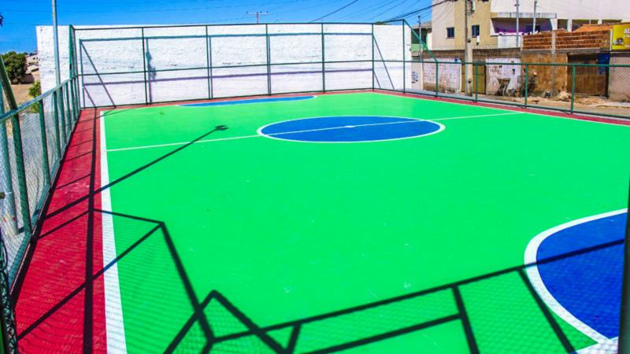
      &lt;text weight="medium" size="xs"&gt;Bright green concrete&lt;/text&gt;
    &lt;/grid-item&gt;
    &lt;grid-item&gt;
      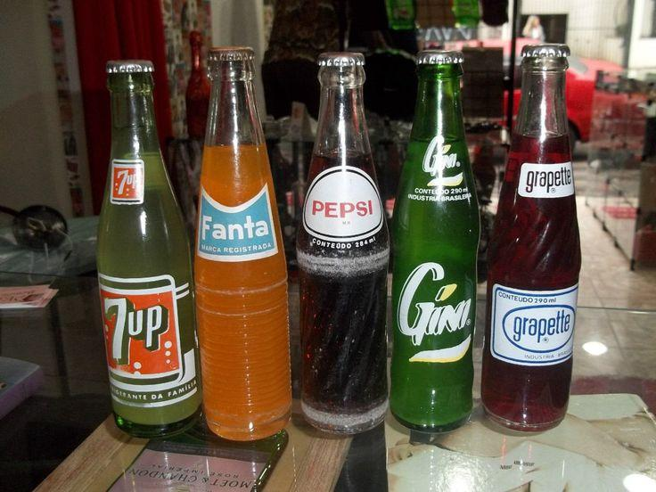
      &lt;text weight="medium" size="xs"&gt;Colorful nostalgic counters&lt;/text&gt;
    &lt;/grid-item&gt;
    &lt;grid-item&gt;
      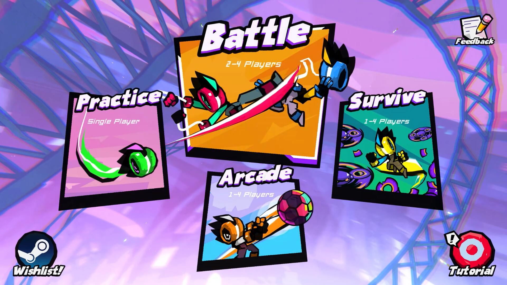
      &lt;text weight="medium" size="xs"&gt;Expressive interface&lt;/text&gt;
    &lt;/grid-item&gt;
    &lt;grid-item&gt;
      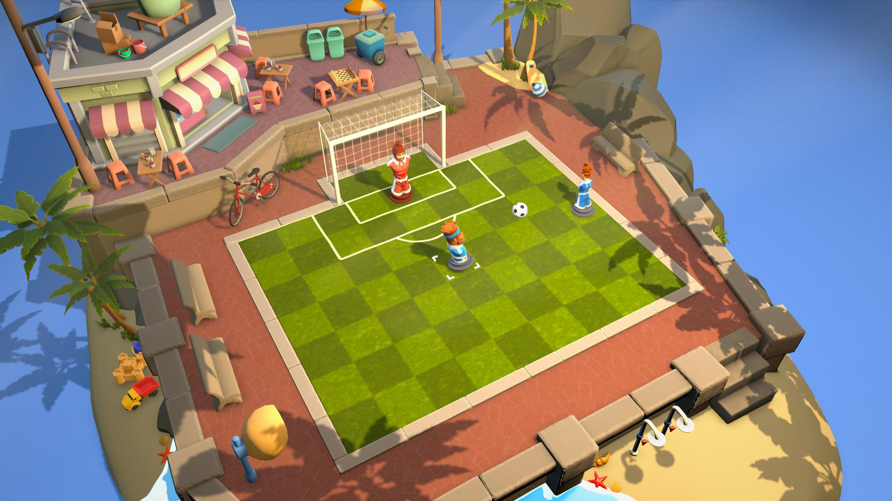
      &lt;text weight="medium" size="xs"&gt;Warm, lively lighting&lt;/text&gt;
    &lt;/grid-item&gt;
  &lt;/grid&gt;
&lt;/box&gt;

### Initial palette exploration

&lt;box gap={2}&gt;
  &lt;grid columns={5} gap="6px"&gt;
    {#each [{c:"#25B85A",n:"Pitch"},{c:"#F8CE46",n:"Energy"},{c:"#F36B3F",n:"Accent"},{c:"#2455D6",n:"Blue"},{c:"#172C23",n:"Contrast"}] as p}
      &lt;grid-item&gt;
        &lt;box background={p.c} height="62px" radius="md"/&gt;
        &lt;text size="2xs" weight="medium"&gt;{p.n}&lt;/text&gt;
        &lt;text size="2xs" color="secondary"&gt;{p.c}&lt;/text&gt;
      &lt;/grid-item&gt;
    {/each}
  &lt;/grid&gt;
  &lt;caption&gt;Exploratory colors, not a finalized brand palette. The game environment and Korre platform should remain visually distinguishable.&lt;/caption&gt;
&lt;/box&gt;

The board can be realistic while the interface is bold and animated. Think tactile materials, strong daylight, expressive goal celebrations, satisfying collisions and colorful caps.

We should avoid both extremes: a dull enterprise-looking interface and an overstimulating casino-like arcade.

## Identity: final interaction

&lt;box border radius="xl" padding={3} gap={3}&gt;
  &lt;box background="#22A85B" theme="dark" radius="lg" padding={4} gap={2} align="center"&gt;
    &lt;title size="2xl" color="#FFFFFF"&gt;COUNTERS.&lt;/title&gt;
    &lt;text color="#FFFFFF" weight="medium"&gt;What should we call you?&lt;/text&gt;
    &lt;text color="#E9FFEF" size="sm"&gt;Pick a username and get in.&lt;/text&gt;
  &lt;/box&gt;
  &lt;box gap={1}&gt;
    &lt;label&gt;Username&lt;/label&gt;
    &lt;input placeholder="Your username" disabled/&gt;
  &lt;/box&gt;
  &lt;button block disabled&gt;Continue &lt;icon name="arrow-right" inline/&gt;&lt;/button&gt;
  &lt;caption&gt;Conceptual onboarding. In the actual game, this appears only when a player has no existing identity.&lt;/caption&gt;
&lt;/box&gt;

The username is mandatory and unique. Behind the scenes, we create a persistent player ID and session. Email remains optional in account settings for recovery.

No signup ceremony, no email verification before playing, no unnecessary onboarding screens.

## Updated execution decision

The stack is now:

- **Babylon.js + Havok** for Counters.
- **Cloudflare Workers + Durable Objects** for realtime multiplayer and authoritative physics.
- **Railway + PostgreSQL** for identity and persistent platform data.
- **Cloudflare-hosted frontend and assets** for fast delivery.
- **Feature-first TypeScript monorepo** with a minimal, engine-agnostic Korre SDK.

And the product direction is clear: **make Counters feel like the colorful, physical Nigerian childhood game, not a generic minimalist web game.**

We're ready to implement the first vertical slice: concrete pitch, bottle caps, button, flick controls and physics. Everything else builds on that.

---

<a id="message-17"></a>

## Message 17 — User

2026-10-10 01:07:17 UTC+01:00 · Message ID: `bb0b500b-1866-462e-9006-e7e8fefb8556`

you sure there's nothing else?...

do a pass on everything for me while I get the local folders and git setup pls

---

<a id="message-18"></a>

## Message 18 — Assistant

2026-10-10 01:07:27 UTC+01:00 · Message ID: `2f4b790c-da6d-5ebc-8167-ab73c7dadd28`

I’ll check the full spec for contradictions, missing gameplay rules, and anything that could trip up implementation. I’ll also verify the Havok and Cloudflare assumptions.

---

<a id="message-19"></a>

## Message 19 — Assistant

2026-10-10 01:07:46 UTC+01:00 · Message ID: `9160bfd9-e0f4-54b1-9ea3-e755d69c3cd4`

**There are a few gaps. We’re ready to start building, but the earlier spec overstated how much was settled.** Most gaps can take sensible defaults. A few traditional rules need your input.

**First, corrections to the existing spec**

| Item | Corrected decision |
|---|---|
| AI | **One basic opponent.** Three difficulties slipped into my summaries without your agreement. |
| Pitch | Open green concrete. The earlier walls decision is superseded. |
| Identity | Unique username required before any play. Email optional later. |
| Visuals | Vibrant, tactile Nigerian nostalgia, with strong colour and lively lighting. |
| Assets | Procedural first. A realistic imported hand is an optional enhancement, not a launch dependency. |
| Modes | AI and online duels. Private matches can change the target score. No additional modes have been defined. |
| Spectating | Invited spectators and waiting friends are in scope. Video streaming is later. |

**The Cloudflare assumption needs one correction**

Cloudflare’s **128 MB limit is per isolate, not guaranteed per match**. Multiple Durable Objects can share an isolate, so allocating “80 MB per match” was not a defensible budget. The documented DO CPU allowance is 30 seconds by default, configurable up to five minutes.  [Source 1](https://developers.cloudflare.com/durable-objects/platform/limits/), [Source 2](https://developers.cloudflare.com/durable-objects/platform/limits/?utm_source=chatgpt.com), [Source 3](https://developers.cloudflare.com/workers/platform/pricing/), [Source 4](https://developers.cloudflare.com/workers/platform/pricing/?utm_source=chatgpt.com).

We still proceed with **Havok inside Durable Objects**. However, published limits cannot prove that the current Havok package initializes and runs there. The first backend task should be loading the actual WASM and resolving one shot in the deployed runtime. That is ordinary integration work, with Railway as the fallback if it fails. No benchmarking project.

**Gameplay details that still need completing**

| Gap | Proposed treatment |
|---|---|
| Counter count | Needs your confirmation. It determines formations and pitch proportions. |
| Physical dimensions, friction and shot strength | Configurable constants, tuned through playing. |
| Goal detection | Whole button crosses the goal line between posts and below the goal height. |
| Goal-line exits outside the goal | Follow your stated throw-in rule unless you want corners or goal kicks. |
| Caps leaving the pitch | Return them near their exit position without overlap or an additional penalty. Proposed default. |
| First shot | Random player starts; conceding player starts after a goal. Proposed default. |
| Ordinary foul | Opponent plays the next two shots. Button contact anywhere during the shot prevents the stated foul. |
| Penalty | Need to decide whether it replaces the extra-shot award or accompanies it. |
| Foul plus goal in one shot | Proposed: a foul invalidates the offending player’s goal. |
| Another foul during bonus shots | Set the offended player’s allowance to two shots, rather than accumulating unlimited bonuses. Proposed default. |
| Throw-ins and penalties | Need exact placement permissions: which cap, whether it can move, and where penalties happen. |
| End of shot | Require sustained low movement, plus a maximum simulated duration to prevent endless rolling. |

Also, **“button” needs a material check**: do you mean an ordinary shirt button, typically plastic? A button attached to clothing should not automatically become a cloth physics object.

**Missing UX and multiplayer behaviour**

These are implementation defaults I’d add:

- **Touch controls:** tap a cap, pull back to aim, release to shoot. A clear cancel gesture. Orbit controls must not compete with aiming.
- **Camera:** preserve each player’s view. Cinematics never change shot outcomes. Each viewer can disable them independently.
- **Playback:** send trajectories **and final state**. Use a shared playback start time; late joiners receive the current shot and playback position.
- **Recovery:** persist accepted actions and settled results. Repeated submissions cannot produce a second shot. A failed simulation restores the previous valid state.
- **Disconnections:** provisional 60-second reconnect window, then forfeit. Browser backgrounding should trigger reconnection, not immediately lose the match.
- **Private queue:** provisional winner stays; next waiting friend challenges. Spectators cannot submit gameplay actions.
- **Invitations:** username lists and shareable links first. Email delivery needs a provider before that feature is complete.
- **Identity:** usernames identify players; a secret session authenticates them. Knowing someone’s username cannot grant account access. Email-free accounts need an optional recovery code.
- **Mobile delivery:** lazy-load the game, cache assets, offer low graphics quality, and provide clear loading failures and retry controls.
- **Audio:** satisfying flicks, collisions and goals, with mute controls. Sound is a major part of making this feel alive.

**Build order:** shared physics and one flick, complete local rules, basic AI, identity, online authority, then spectating and invitations. Integrate the Cloudflare shot runner early so infrastructure surprises surface before substantial polish.

Three answers would close the biggest gameplay gaps:

1. **How many caps per player, and does one act as a goalkeeper?**
2. **Does a penalty replace the two-shot award? Where is it taken, and can the shooting cap be repositioned?**
3. **For a throw-in, can the player move their cap to the exit point, or must they use a cap already nearby?**

---

